<p align="center">
  
</p>

<p align="center">
  <a href="https://github.com/agenerela/agenerela/releases/latest"></a>
  <a href="https://github.com/agenerela/agenerela/actions/workflows/repo-hygiene.yml"></a>
  
  
  
</p>

<p align="center">
  <b>Let a language model drive your game's characters without handing it your game.</b><br>
  NPCs, companions, factions, colonies: the model picks from the actions you registered,<br>
  and your own C# code checks the choice and runs it.
</p>

<p align="center">
  <a href="#a-quick-look">Quick look</a> ·
  <a href="#how-it-works">How it works</a> ·
  <a href="#does-it-work">Does it work?</a> ·
  <a href="#roadmap">Roadmap</a> ·
  <a href="#installing">Installing</a> ·
  <a href="#developing">Developing</a> ·
  <a href="docs/FRAMEWORK_BUILD_PLAN.md">Build plan</a>
</p>

> [!NOTE]
> **Early development.** The core is built and tested: registered actions, availability from
> state, the decision schema, prompts and the `Agent` that joins them. Since 0.3.0 it calls a
> local model through Ollama, with a request queue and short-term memory; the guards that stop
> a wrong answer are Phase 3, now under way. The [changelog](CHANGELOG.md) has the detail.

## A quick look

Mark the methods a character may use. Each one is an action the model can choose, and the code
that runs when it does:

```csharp
public class Guard : MonoBehaviour
{
    bool following;

    [AgentAction("move_to", "Walk to a named place.", RequiresTarget = true)]
    [Example("Head over to the {0}.", "tower", "bridge")]
    void MoveTo(Transform place) => GetComponent<NavMeshAgent>().SetDestination(place.position);

    [AgentAction("follow_player", "Walk behind the player.")]
    void Follow() => following = true;

    // While this is false, follow_player is never offered to the model.
    [Available("follow_player")]
    bool CanFollow() => !following;
}
```

Then ask the agent whenever your game decides it should act: a player's line, an event, a turn.

```csharp
var agent = new Agent(profile, provider);
agent.Actions.RegisterMethods(guard);

DecisionResult result = await agent.DecideAsync("Go to the tower.");
agent.Execute(result);   // checked again, then Guard.MoveTo runs
```

The agent is plain C#, not a `MonoBehaviour`, so a faction or a whole country can be one too,
with no GameObject at all.

## How it works

<p align="center">
  
</p>

There are two independent safety layers. Actions that are illegal right now, and targets that
don't exist, are **left out of what the model is allowed to write**, so it can't name them.
And `Execute` **checks the decision again** against the game as it is at that moment, so even a
provider that ignores the rules is contained. The model never touches Unity.

The whole design, with every extension point you can implement, is in the
[framework figure](docs/design/png/07-framework-design.png) and the
[build plan](docs/FRAMEWORK_BUILD_PLAN.md).

## Does it work?

Small local models are cheap and private, but on their own they are unreliable game masters:
told the rules in plain text, they often pick the wrong action. Agenerela is built from a
prototype that measured what fixes that, with the same small model (2B parameters) in each
comparison:

- **Giving the model only the legal actions, instead of describing the rules in the prompt**,
  took it from 31 to 45 right answers out of the same 53 test commands.
- **With the checks added**, the small model got 19 of 20 player commands right. A model twice
  its size, without them, got 13.

The checks matter more than the model's size, which is why the model is a swappable part
behind an interface. The full measurements and their caveats are in
[appendix A of the build plan](docs/FRAMEWORK_BUILD_PLAN.md); the framework's own benchmark
arrives in Phase 4.

## Roadmap

<p align="center">
  
</p>

Each phase closes with a release. What has changed is in the [changelog](CHANGELOG.md), and
the API changes in the package's own
[changelog](UnityProject/Packages/com.agenerela.framework/CHANGELOG.md); what each phase must
do to close is in the build plan's phase table.

## Installing

In Unity 6 (6000.0 or later), open *Window → Package Manager → + → Install package from git
URL* and paste:

```
https://github.com/agenerela/agenerela.git?path=UnityProject/Packages/com.agenerela.framework#v0.3.0
```

The part after `#` is the release tag. Use the one on the release badge above for the latest
release, and change it to upgrade. Each [release](https://github.com/agenerela/agenerela/releases)
says what it adds and what is still missing.

Newtonsoft JSON, the package's one dependency, installs with it: no scoped registry, no native
binaries. Scripts outside any assembly definition see the API straight away; if your game code
has its own `.asmdef`, add `Agenerela` to its references.

Today the only provider is [Ollama](https://ollama.com), so it must be running with a model
pulled (for example `ollama pull qwen3.5:4b`) before an agent can decide.

## Developing

Requires **Unity 6000.3.23f1** (pinned; see the build plan §6.2) and
[Ollama](https://ollama.com) with a local model for the development provider:

```bash
git clone https://github.com/agenerela/agenerela.git
ollama pull qwen3.5:4b
```

Open `UnityProject/` in Unity. The package is embedded, so it compiles automatically. Run the
tests from **Window → General → Test Runner → EditMode**. Each demo game is a separate Unity
project under `Demos/`; see [`Demos/README.md`](Demos/README.md).

Copy `.env.example` to `.env` if you intend to test a cloud provider. `.env` is gitignored and
must never be committed.

<details>
<summary><b>One setup step per machine: Unity's merge tool</b></summary>

Wire up Unity's YAML merge tool so scene and prefab conflicts can be merged:

```bash
git config merge.unityyamlmerge.name "Unity SmartMerge"
git config merge.unityyamlmerge.driver '"C:/Program Files/Unity/Hub/Editor/6000.3.23f1/Editor/Data/Tools/UnityYAMLMerge.exe" merge -p "$BASE" "$REMOTE" "$LOCAL" "$MERGED"'
git config merge.unityyamlmerge.recursive binary
```

</details>

<details>
<summary><b>Repository layout</b></summary>

| Path | Contents |
|---|---|
| `UnityProject/Packages/com.agenerela.framework/` | The package — everything shippable |
| `UnityProject/Assets/Evaluation/` | Prompt set, the first 54 prompts so far, and the agent they are measured against; the accuracy benchmark harness is Phase 4 |
| `Demos/` | Demo games, one Unity project each (not shipped to consumers) |
| `docs/FRAMEWORK_BUILD_PLAN.md` | Architecture, build phases, decision records |
| `docs/llm-wiki/` | Measured findings and working conventions |
| `docs/design/` | Sitemap, screen wireframes and the developer walkthrough — what a developer and a player see |
| `docs/course/` | COMP 490 deliverables: requirements, interviews, the sketch lab |
| `tools/benchmarks/` | Standalone probes for fast iteration outside Unity |
| `tools/ci/` | The repo hygiene checks CI runs, runnable locally, and the release script ([`docs/RELEASING.md`](docs/RELEASING.md)) |
| `tools/comfyui/` | Asset server for the demo games: 3D models, sounds and images from ComfyUI on a separate GPU machine |
| `AGENTS.md` | Rules for AI coding agents — and the shortest description of how this project works |
| `CONTRIBUTING.md`, `REVIEWING.md` | Opening a pull request, and reviewing one |

</details>

## Related work

[LLMUnity](https://github.com/undreamai/LLMUnity) runs a model inside Unity and is the intended
in-process provider. It answers *"how do I run a model in Unity?"*; Agenerela answers *"which
action may this agent take, is the model's choice legal, and was it even asked for?"* It sits
below this framework, not alongside it.

## License

To be confirmed — MIT intended, pending a university IP review. Until a `LICENSE` file is added,
all rights are reserved and this code is published for review only.

---

<p align="center"><sub>Senior design project, CSUN COMP 490 / 491.</sub></p>
