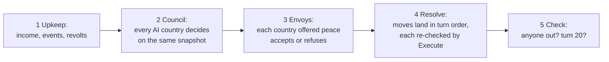

# GreyBoxStrategy — four countries, one decision each a turn

**Status:** a design draft, written 9 November 2026 for #20. Nothing is built yet. The
numbers are starting values to tune in the grey box. The shape is the proposal: one
screen, no scene, no art, countries as plain objects.

> **Why it is written now.** GreyBoxVillage and Living Vale are 3D, and most of their cost
> went into things the framework never touches: terrain, cameras, animation, navigation,
> art. This demo has none of that. Its whole world is about 15 numbers per country and a
> grid of coloured boxes. Nearly all the work is the part that shows off the framework.
>
> **#20 is out of date.** It was written when demos lived inside `UnityProject/` and used
> `Demos.Shared`. Demos are separate projects now (DR-010), and the framework exists. This
> page replaces #20's *What to build*. Its four questions are answered below.

## In plain terms

Four countries share a map of twelve provinces. Each turn, every country picks one move:
raise an army, build a fort, raise taxes, declare war, attack, or offer peace. A model
chooses each AI country's move from the moves that are legal for it right now. Its
one-line proclamation goes into the event log, and its move changes the map. After 20
turns, the country holding the most provinces wins.

The player either plays one country with buttons or watches all four play themselves
(*Spectate*). The buttons offer exactly the moves a model would be offered in that
country's place, so the player can see that the illegal ones are not there.

## What it proves that the other demos don't

| Demo | Its agent | Has a body? | Who asks it |
|---|---|---|---|
| GreyBoxVillage | a guard | yes, 3D | the player types |
| Living Vale | a trader or a quest-giver | yes, 3D | the player types |
| **GreyBoxStrategy** | **a country** | **no: no GameObject, no Transform, no scene query** | **the game, once a turn, and other countries** |

1. **An agent is not an NPC** (build plan §1.2, DR-011). Countries are `new Agent(identity,
   actions, provider)` in plain C#. Only the UI is a `MonoBehaviour`.
2. **Agent to agent.** An offer of peace from one country is the other country's stimulus.
   That country answers it with its own agent, and only *accept* or *refuse* is offered
   during that call.
3. **Stale decisions in a turn.** Every country decides on the same snapshot of the world,
   then the moves land one at a time. `Execute`'s re-check refuses a move an earlier one
   made stale, for example an attack on a country that has just made peace, and the log
   says so.
4. **Targets whose meaning is state.** A country is offered as a target in the category
   `at_war`, `at_peace` or `truce`. `declare_war` takes only `at_peace`, while `attack` and
   `offer_peace` take only `at_war`. The category guard (#208) and, in one A/B arm, the
   paired schema (#210) do the rest.
5. **The `turn` category of the evaluation set**, empty until now (`Assets/Evaluation/README.md`).
   A country is the second agent definition it waits for.

## The world

Grey box means grey box: a 4 × 3 grid of rectangles, each filled with its owner's colour,
plus numbers and a log. There are no sprites, no models and no binary files, so nothing
goes through Git LFS.

| id | Name | Personality (sent as `AgentIdentity.Personality`) | Starts with |
|---|---|---|---|
| `valen` | Valen | Proud and quick to take offence; believes strength earns respect. | 60 gold, army 50, 0 forts |
| `orsk` | Orsk | A merchant republic; prefers coin to blood, never forgets a betrayal. | 120 gold, army 30, 0 forts |
| `merrow` | Merrow | Small and devout; defends what it has and trusts no one. | 60 gold, army 20, 1 fort |
| `ilvar` | Ilvar | Ambitious and patient; strikes whoever is weakest. | 80 gold, army 40, 0 forts |

Every country starts with three provinces, stability 3 of 5 and peace with everyone.
`Goals`, the same for all four: *"Hold the most provinces when turn 20 ends."*

**Economy.** Income is 10 gold per province. Upkeep is 1 gold per 5 soldiers. A country
whose gold falls below 0 loses 10 soldiers to desertion. Stability rises by 1, up to 5,
after any turn without a tax rise. A country at stability 1 has a 1 in 3 chance each turn
of a revolt, which costs it 20 soldiers and all its gold.

**Events.** Each turn, one country rolls one event (seeded): a poor harvest (income
halved), a good harvest (+20 gold), bandits (−10 soldiers) or a quiet turn.

**Battle.** Attack strength = attacker's army × a roll from 0.8 to 1.2. Defence strength =
defender's army × a roll + 15 per fort. If the attacker wins, it takes one of the
defender's provinces, loses 25% of its army, and the defender loses 40%. If it loses, it
loses 40% and the defender loses 20%. A country with no provinces is out.

**The dice are seeded**, the way Risk race's are: each roll is a hash of *(game seed, turn,
country, purpose)*, not the next number from a shared generator. Two games with one seed
roll the same dice even when the countries decide differently, which is what makes an A/B
run over a whole game fair (hard rule 2).

## A turn



- **Council.** All living AI countries are asked at once, so the queue serialises them
  (§2.6). The panel shows who is deciding. With `qwen3.5:2b` warm (under 0.6 s a decision,
  findings 25 October), four countries take about 2 to 4 s.
- **Resolve order** rotates each turn so no country always moves first. Peace accepted in
  step 3 lands first, then declarations, then attacks, then the moves that only touch the
  country itself.
- **The world waits.** This is the turn-based demo; deadlines belong to Risk race.

## The four questions from #20

### 1. When does the game call `DecideAsync`?

| Moment | `StimulusLabel` | Stimulus | Offered | Priority |
|---|---|---|---|---|
| **Council**, once per living AI country per turn | `Council` | The turn's headline, chosen by game code: *"Turn 7 of 20. orsk took Fenmark from us."* or *"Turn 3 of 20. Nothing has changed."* | the six council moves and `none` | `Background` in Spectate, `PlayerFacing` while the player waits for End Turn |
| **Envoy**, when another country offers peace | `Envoy` | *"orsk offers peace."* (`Correlation` is the offer) | `accept_peace`, `refuse_peace`, `none` (counts as refusing) | same as the council |
| **Advisor**, optional, for the player's own country | `Advisor` | the council's stimulus | the council moves | `PlayerFacing`. The answer is shown as a suggestion and is never executed by itself |

The stimulus carries the headline, rather than a bare *"Choose your move"*, for a reason
the framework forces: a few-shot example is a stimulus and an answer, with no observations
(`ExampleAttribute`). With the same stimulus every turn, no example could show *when* to
raise taxes. With a headline, it can: *"Turn 4 of 20. The treasury is almost empty."* →
`raise_taxes`. That limit is proposal F2 in [`demo-lineup.md`](demo-lineup.md).

Council and envoy moves are kept apart through `[Available]` reading
`DecideOptions.Correlation` (#195). There is no second agent and no second registry.

### 2. What observations does a country get?

They come from one `CountryObservationSource : IObservationSource`, which reads the world
at decision time. There are at most eight lines, `Agent.MaxObservations`' default, and
every line names other countries by their target id:

```text
Treasury: 120 gold, income 30 a turn, upkeep 9.
Army: 45 soldiers. Forts: 1. Provinces: 3. Stability: 2 of 5.
orsk: at war with us. Army 60, 4 provinces.
valen: at peace with us. Army 20, 2 provinces.
ilvar: truce with us for 2 more turns. Army 35, 3 provinces.
Last turn: we attacked orsk and lost 18 soldiers.
Harvest was poor: income is halved this turn.
Stability 1 risks a revolt.
```

Line 6, *what happened last turn*, is game code standing in for something memory cannot do
today. `RollingHistory` replays what the country *chose* (`attack orsk`), never what came of
it. That is proposal F1.

### 3. The moves

| id | Target | Offered when (`[Available]`) | What the handler does |
|---|---|---|---|
| `raise_army` | none | gold ≥ 30 | −30 gold, +15 soldiers |
| `build_fort` | none | gold ≥ 40 and forts < 3 | −40 gold, +1 fort |
| `raise_taxes` | none | stability ≥ 2 | +40 gold, −1 stability |
| `declare_war` | `at_peace` | army ≥ 30 | relation becomes war, for both sides |
| `attack` | `at_war` | army ≥ 10 and at war with someone | resolves a battle; the winner may take a province |
| `offer_peace` | `at_war` | at war with someone | sends an envoy; the target answers in step 3 |
| `accept_peace` | none | only in an Envoy call | war becomes a 3-turn truce |
| `refuse_peace` | none | only in an Envoy call | nothing changes; the log says so |
| `none` | none | always | nothing |

Targets come from a `RelationTargetSource : ITargetSource`, one per country. Each time it
collects, it registers every other living country under its id, in the category of its
relation to this country. A truce is its own category, so `declare_war` cannot pick a
country it has just made peace with. That is per-target availability expressed as a
category, because the framework has no other way to say it yet (proposal F3).

Each move gets one `[Example]` with a headline stimulus, plus a `[CounterExample]` where
one helps. They are written fresh, never taken from the evaluation set (hard rule 4).
Descriptions stay one short clause of similar length (`AgentActionAttribute`'s rule).

### 4. The statement

A one-sentence proclamation, shown in the event log beside the move: *"Valen will not be
insulted twice. We march on Orsk."* It may be empty, and then the log shows the move alone.
A refused decision shows `RefusalStatement`'s line. The free text is never parsed for
meaning: the move is the action field, as in every other demo.

## Memory and guards

- `RollingHistory(6)` with `MemoryCommit.OnExecute`, so a move refused at resolve is never
  remembered as made (#195). Six exchanges is about the last five turns plus an envoy.
- The default guards, plus the category guard. There is no developer guard to begin with,
  because availability covers the rules. A guard gets added only if play shows a gap
  availability cannot close.
- `ListActionsAndTargets` is on, since Ollama never reads the schema (findings,
  10 October). `PairTargetsWithActions` is on in one A/B arm and off in the other.

## The screen

This is screen 6 of the UI map (`docs/design/png/06-strategy.png`, `screen-notes.md`),
built in UI Toolkit from code: ① the turn bar with End Turn and a deciding bar, ② the map,
③ the selected country's numbers, ④ its observations this turn, verbatim, ⑤ the moves it is
offered, ⑥ the event log. The player's country gets the same ⑤ as buttons, with a target
dropdown filtered by category. A Spectate toggle plays turns by itself, one every few
seconds, for presenting.

## Project and code layout

`Demos/GreyBoxStrategy/`, created with `Demos/README.md`'s checklist. The template is
Universal 2D, though nothing renders except UI.

```text
Assets/GreyBoxStrategy/
  Sim/        World, Country, Province, Battle, Dice, TurnRunner: plain C#, no UnityEngine scene types
  Agents/     CountryMoves ([AgentAction] methods), RelationTargetSource, CountryObservationSource,
              CountryAgents (builds the four Agents, runs council and envoys)
  UI/         StrategyScreen (the one MonoBehaviour), USS
  Tests/EditMode/  rules, dice, a whole 20-turn game on ScriptedProvider
  Tests/PlayMode/  one RequiresOllama game of 5 turns
```

`TurnRunner` takes an `IMoveSource` per country (a model, the player's buttons, or a script),
so the simulation runs and is tested without the framework at all.

## How it gets built and checked

Each slice is one pull request into `test`. Every check below runs with no person at the
keyboard.

| Slice | Contents | Done when |
|---|---|---|
| **S1 — the board game** | `Sim/`, the screen, the player's buttons, scripted rivals. #20's grey box | EditMode: every rule and the dice; a seeded 20-turn game always ends the same way |
| **S2 — countries decide** | `Agents/`, council only, through `ScriptedProvider`, then Ollama | EditMode: a scripted whole game, a stale move refused, a mismatched category refused. Live: a 5-turn game on `qwen3.5:2b` with no pipeline errors |
| **S3 — envoys and the player** | Peace offers and replies, the Advisor button, Spectate | EditMode: offer, accept, refuse, `none` counts as refusing; an attack on a country that just made peace is refused |
| **S4 — measured** | 20+ `turn` prompts against a `country` agent definition, labelled blind; the A/B arms above | Results in `findings.md`, with the control arm |

The checks used: EditMode and PlayMode runs in Unity batch mode from a worktree, the
hygiene script, a live game through Ollama's HTTP API at `127.0.0.1`, and screenshots of
the running game. What none of them can judge is whether a game is *fun to watch*, and
whether the personalities read differently. That needs a person to play it after S3.

## Risks

- **A small model may pick `none`, or `attack`, almost every turn.** Then the fix is the
  headline stimuli and examples, measured, not stronger wording (Appendix A).
- **The personalities may not show.** A 2B model may play all four the same way. That is
  a finding worth recording either way, and a reason to try `qwen3.5:4b` and `gemma4:e2b`
  in S4.
- **Balance.** If war never pays, or always does, tune the numbers in S1, before any model
  is involved.

## What this demo needs from the framework

Per demo and in one list, with what exists today and what does not:
[`demo-lineup.md`](demo-lineup.md).
