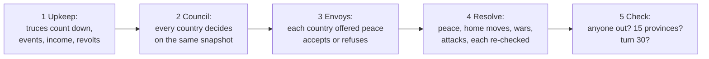

# GreyBoxStrategy — five countries, one decision each a turn

**Status:** stages 1 and 2 of 3 are built (10 November 2026, #20). Stage 1 is the rules as a
headless simulation, a scripted AI with two temperaments, a random baseline, and a runner that
plays whole games and logs them. In stage 2 a framework agent plays one seat, measured on the
RTX 5080; neither `qwen3.5:4b` nor `qwen3.5:2b` plays better than a random player yet, and the
demo's `README.md` has the numbers and why. There is no screen yet. The project is
[`Demos/GreyBoxStrategy/`](../../Demos/GreyBoxStrategy/README.md); its `README.md` answers
#20's four questions with the literal sentences a country will read, and lists what the
framework still lacks for this game. This page is the design: the rules, why they are what they
are, and what changed from the first draft of 9 November.

> **Why this demo.** GreyBoxVillage and Living Vale are 3D, and most of their cost went into
> things the framework never touches: terrain, cameras, animation, navigation, art. A country
> here is a handful of numbers, so nearly all the work is the part that shows off the framework.
> The name stays GreyBoxStrategy for now; the finished game is meant to look good, not grey, so
> it may change at stage 3.

## In plain terms

Five countries share a map of 25 provinces. Ten of them start neutral, so from turn 1 the map
fills with colour as countries grab land. Each turn every country makes one move: recruit, build
a fort, raise taxes, declare war, attack a province, or offer peace. A country offered peace
answers it, accept or refuse, before anything lands. The first country to hold 15 provinces
wins; if nobody has by turn 30, the one holding the most does.

The finished game's centrepiece is that map being coloured as provinces change hands, so the
rules are tuned for territory to move often: a province changes hands 1.5 times a turn on
average, and only 11% of turns pass with none changing (measured below).

## What it proves that the other demos don't

| Demo | Its agent | Has a body? | Who asks it |
|---|---|---|---|
| GreyBoxVillage | a guard | yes, 3D | the player types |
| Living Vale | a trader or a quest-giver | yes, 3D | the player types |
| **GreyBoxStrategy** | **a country** | **no: no GameObject, no Transform, no scene query** | **the game, once a turn, and other countries** |

1. **An agent is not an NPC** (build plan §1.2, DR-011). The simulation assembly has
   `noEngineReferences: true`: it cannot name a `GameObject` even by accident.
2. **Agent to agent.** An offer of peace from one country is a moment for the other, which
   answers with its own agent; only *accept* or *refuse* is offered then.
3. **Stale decisions in a turn.** Every country decides on the same snapshot, then moves land
   one at a time and each is re-checked first. An attack on a country that has just made peace,
   or on a neutral province another country took a moment earlier, is refused and logged. In
   200 games that happened about six times a game.
4. **Targets whose meaning is state.** Two kinds of target, countries and provinces, whose
   legality depends on relations and borders: per-target availability (`ITargetAvailability`,
   #216 item 5) in a game that needs it on every action that takes a target.
5. **The `turn` category of the evaluation set**, still empty (`Assets/Evaluation/README.md`).

## The map

A 5 × 5 board. Borders are the four orthogonal neighbours, so the screen can draw the map from
the same graph the rules read, and the map is symmetric left to right and top to bottom.
`*` marks a capital, `.` a neutral province.

```text
         col 0         col 1          col 2           col 3          col 4
row 0  highmoor* V   ashby V       stonereach .    corwick O      orskhaven* O
row 1  brindle V     fenmark .     templegate M    saltmere .     redcliff O
row 2  westmarch .   harrow .      merrowdeep* M   glimmerford .  eastwatch .
row 3  thornbury K   ravenholt .   pilgrimsrest M  duskvale .     ilmoor I
row 4  keshtar* K    marrowfield K southgate .     oakhollow I    ilvarion* I
```

| id | Country | Personality (stage 2 sends it as `AgentIdentity.Personality`) |
|---|---|---|
| `valen` | Valen, north-west | Proud and quick to take offence; believes strength earns respect. |
| `orsk` | Orsk, north-east | A merchant republic; prefers coin to blood, never forgets a betrayal. |
| `merrow` | Merrow, the middle | Small and devout; defends what it has and trusts no one. |
| `kesh` | Kesh, south-west | Hill clans under one banner; fierce in war, quick to make peace when it pays. |
| `ilvar` | Ilvar, south-east | Ambitious and patient; strikes whoever is weakest. |

Every country starts with three provinces, one of them a capital with one fort, 40 gold, 30
soldiers, stability 3 of 5, and peace with everyone. Merrow touches eight neutral provinces and
each corner touches three, so Merrow can grow fastest and is also the first to be surrounded.
Neutral provinces have a garrison of 8 to 16, rolled from the seed.

## The rules

Every number is in `GameRules`, so the game can be tuned without touching the rules.

**Economy.** Income is 10 gold per province. Upkeep is 1 gold per 2 soldiers. A treasury that
goes below zero is set to zero and 15% of the army deserts.

**Stability.** It rises by 1, up to 5, after any turn without a tax rise. At stability 1 a
country has a 1 in 3 chance each turn that a province other than its capital revolts and turns
neutral again, with a garrison of 10; stability then resets to 3.

**Events.** Each turn each country rolls once: a good harvest (7%, +25 gold), a poor harvest
(7%, income halved this turn), bandits (5%, −5 soldiers), unrest (4%, −1 stability), or
nothing.

**Battle.** Attack = the attacker's army × a roll from 0.8 to 1.2. A neutral province defends
with its garrison × a roll, plus 15 per fort. A country's province defends with 70% of the
owner's whole army × a roll, plus 15 per fort, plus 8 for a capital. The attacker wins if its
attack is higher. Each side loses 30% of the other side's strength, the holder only 60% of that
when it holds. A province that falls loses one fort. A country with no province is out.

**Dice are seeded per purpose.** Every roll is a hash of *(game seed, turn, who, purpose)*,
never the next number from a shared generator. Two games with one seed roll the same dice for
the same battle even when the countries decided differently on the way there, which is what
makes an A/B run over a whole game fair (hard rule 2), and what lets stage 2 compare a model
and the scripted AI on the same luck.

## A turn



- **Council and envoys** decide on the state as it stood after upkeep; nothing changes until
  every answer is in. Two countries that offer each other peace in one turn make it without
  being asked.
- **Resolve** lands peace first, then home moves (recruit, taxes, forts), then declarations of
  war, then attacks. Within each step countries go in seat order starting one seat later each
  turn. Every move is re-checked with the same rule that offered it, and refused with the reason
  if an earlier move made it stale.

## The moves

| id | Target | Offered when | What it does |
|---|---|---|---|
| `recruit` | none | the treasury pays for at least 5 soldiers | a levy of 5 + 5 per province held, at 2 gold a soldier, cut to what the treasury pays for |
| `fortify` | a province of ours | 30 gold, fewer than 2 forts there, and it borders a province we don't hold | +1 fort there |
| `raise_taxes` | none | stability ≥ 2 | +30 gold, −1 stability, and stability does not recover next upkeep |
| `declare_war` | a country | at peace (not truce) with it, it borders us, army ≥ 20 | war, for both sides |
| `attack` | a province | it borders ours, army ≥ 10, and it is neutral or held by a country we are at war with | a battle; the winner takes it |
| `offer_peace` | a country | at war with it | an envoy; it answers before resolution |
| `none` | none | always | hold |
| `accept_peace` | none | only when answering an envoy | war becomes a 5-turn truce |
| `refuse_peace` | none | only when answering an envoy | nothing changes |

Every rule above is one function, `Legality.WhyNot`, that returns a reason or nothing. The list
a player is offered and the re-check at resolution both call it, so they cannot disagree, and
stage 2 maps it straight onto `[Available]` and `[AvailableFor]`, which carry a reason too.

## Facts: standing and this turn

A country decides on two kinds of fact, kept apart from the start, because
`DecideOptions.ObservationPlacement.WithStimulus` (#239) helps only when they are:

- **Standing facts**, true on every call: the turn and score, the treasury, the army and
  stability, each rival's relation, army and provinces, and how many neutral provinces border
  us. At most eight lines, so they fit `Agent.MaxObservations`. In stage 2 an
  `IObservationSource` returns them.
- **This turn's facts**, the one to three things that just happened to this country, most
  important first: land lost, a war declared on it, an attack that failed, a harvest. In stage 2
  they go with the call, after the stimulus.

The literal sentences, at each moment, are in the demo's `README.md`.

## Measured: does the game reward good play?

200 games, the mixed line-up (two expansionists, two cautious, one random player, seats rotating
each game so every kind plays every country equally often), seeds 1 to 200, the standard rules:

| Player | Seats | Wins | Win rate | Mean provinces at the end | Knocked out |
|---|---:|---:|---:|---:|---:|
| expansionist | 400 | 106 | 27% | 5.7 | 181 |
| cautious | 400 | 94 | 24% | 6.4 | 141 |
| random | 200 | 0 | 0% | 0.8 | 149 |

One scripted player against four random ones wins 99% (expansionist) and 98% (cautious) of 200
games. A game lasts 21.7 turns on average (15 to 30), and 191 of 200 end in an outright win of
15 provinces rather than at the turn limit. The full tables, with territory changes per turn, are
in the demo's `README.md` and in every run's `summary.md`.

The scripted AI never reads the dice. What it does is in `ScriptedPlayer`: make peace when
outmatched, take the best province the odds allow, keep up with the strongest neighbour, start a
war when no free land is left, join a war on a country close to winning, recruit, raise taxes
when broke. The two temperaments differ in the odds they accept, whether they build forts, and
how readily they make peace.

## What changed from the first draft, and why

| Draft (9 November) | Now | Why |
|---|---|---|
| Four countries, a 4 × 3 grid, every province owned | Five countries, a 5 × 5 board, ten provinces neutral | The map colours from turn 1 (2.2 provinces change hands a turn in turns 1 to 5); a middle country breaks the four-corner standoff |
| `attack` targets a country | `attack` targets a province | Territory is the core loop and the screen colours provinces, so the province is what a country chooses. Two kinds of target also exercise per-target availability |
| Forts per country | Forts per province, on border provinces only | A fort is something the map can show, and a per-target rule |
| `raise_army`: 30 gold for 15 soldiers | `recruit`: a levy that grows with provinces held, 2 gold a soldier | Measured in the simulation: a fixed levy left treasuries at hundreds of gold by turn 12 with armies of under 20, so gold meant nothing |
| Upkeep 1 per 5 soldiers | 1 per 2 | The same measurement: upkeep has to bite for an army to cost something |
| Most provinces after turn 20 | 15 provinces wins at once; otherwise most provinces after turn 30 | A game wants a climax. 191 of 200 now end in one |
| A revolt costs 20 soldiers and all gold | A revolt frees a province | It changes the map, which is the part the game is about |
| One country rolls an event a turn | Every country rolls each turn, 23% for something | More turn facts to react to |
| 3-turn truce | 5 turns | With one move a turn, three turns ended a truce before it changed anything |
| Peace, declarations, attacks, then home moves | Peace, home moves, declarations, attacks | A levy raised the turn war is declared defends that turn, so recruiting in answer to a threat means something |
| `IMoveSource` | `IPlayer`, and `Game`'s three calls | One synchronous interface for scripts; stage 2 drives the three calls itself and awaits every agent on one snapshot |

## The three stages

The order the lead agreed on 10 November 2026, replacing the draft's slices S1 to S4:

| Stage | Contents | Done when |
|---|---|---|
| **1. The game, headless** (built) | `Sim/`: rules, legality, turn resolution, seeded dice, the scripted AI and random players, the runner and its logs | EditMode tests for every rule, legality, determinism, termination, and scripted beating random; a 200-game summary |
| **2. A model as a player** (built) | `Agents/`: a framework `Agent` in one seat, council and envoy moments, `Agent.Execute` as the re-check when a move lands, measured against the scripted AI on the RTX 5080 | Games where one seat is a model and the rest are scripted, compared seat for seat on the same seeds; results in `findings.md` with the scripted control |
| **3. The map and the screen** | The board coloured by owner as territory changes, the turn bar, the selected country's facts and offered moves, the event log; spectate and play one country | Screenshots through the Unity CLI; a person plays it |

Stage 2 asks the design questions that need a model (the stimulus, examples, the A/B arms);
stage 3 asks the visual ones, with the lead. Stage 3's proposed design, with mock-ups and its
open questions, is [`grey-box-strategy-screen.md`](grey-box-strategy-screen.md).

## Project layout

```text
Demos/GreyBoxStrategy/Assets/GreyBoxStrategy/
  Sim/                   GreyBoxStrategy.Sim, noEngineReferences: plain C#, no UnityEngine at all
    Rules/               Dice, GameRules, MapDefinition, World, Move, Legality, Facts, Requests, Game
    Players/             IPlayer, ScriptedPlayer (Temperament), RandomPlayer
    Runner/              GameRunner, Lineups, SeriesSummary, GameLog, StrategyRuns
  Editor/                GreyBoxStrategy.Editor: the menu and the Unity CLI entry point
  Tests/Editor/          GreyBoxStrategy.Tests.Editor
```

Stage 2 adds `Agents/` with the game's own assembly, `GreyBoxStrategy`, referencing `Agenerela`
and `GreyBoxStrategy.Sim`, as `Demos/README.md` asks.

## Risks

- **A small model may pick `attack` or `none` almost every turn.** Then the fix is the stimulus
  and examples, measured, not stronger wording (Appendix A). The scripted AI is the yardstick.
- **The personalities may not show.** A small model may play all five the same way. That is a
  finding either way.
- **Balance against a model.** The scripted AI is tuned to beat random by a wide margin and to
  keep the two temperaments close. A model that plays very differently may expose a dominant
  move the scripts never tried; the runner's logs are where that would show.

## What this demo needs from the framework

Checked against #216 in the demo's `README.md`; the cross-demo list is
[`demo-lineup.md`](demo-lineup.md).
