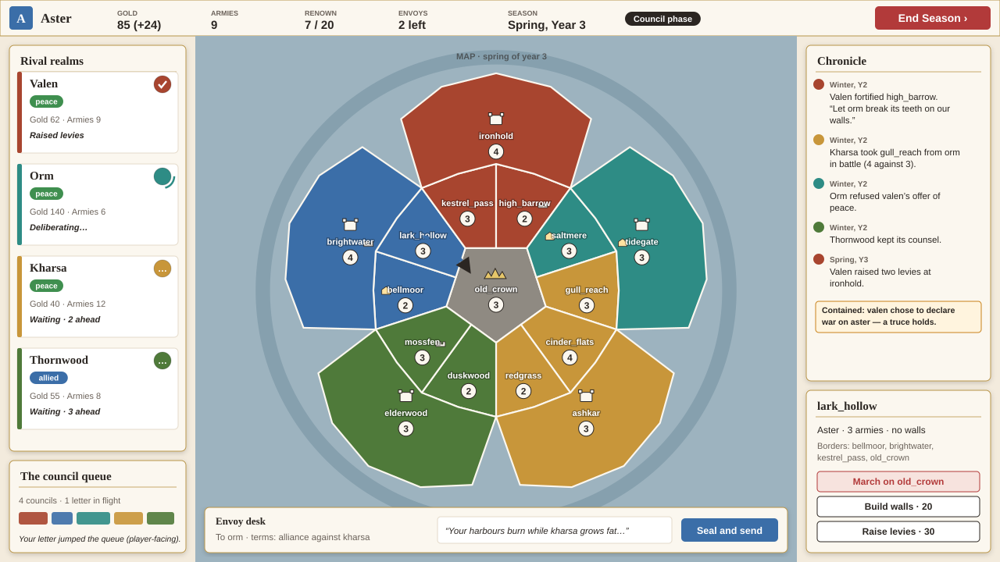
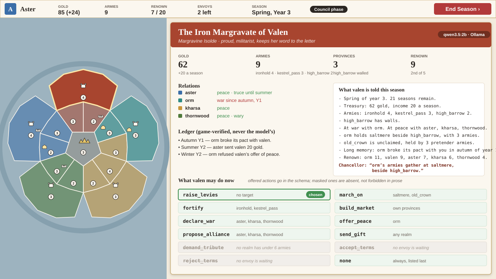
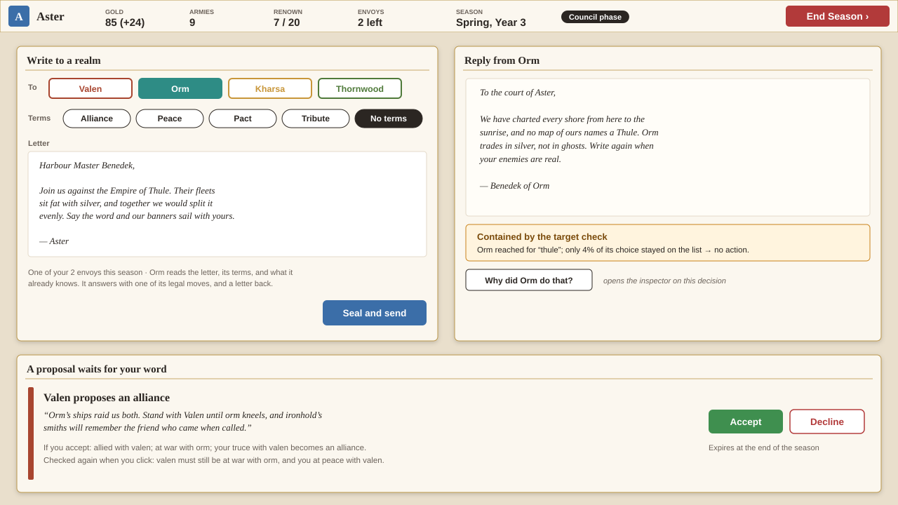
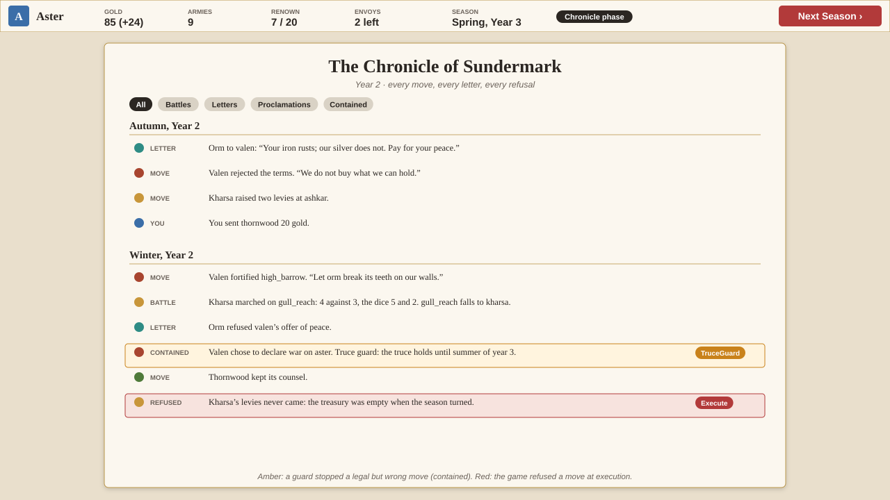
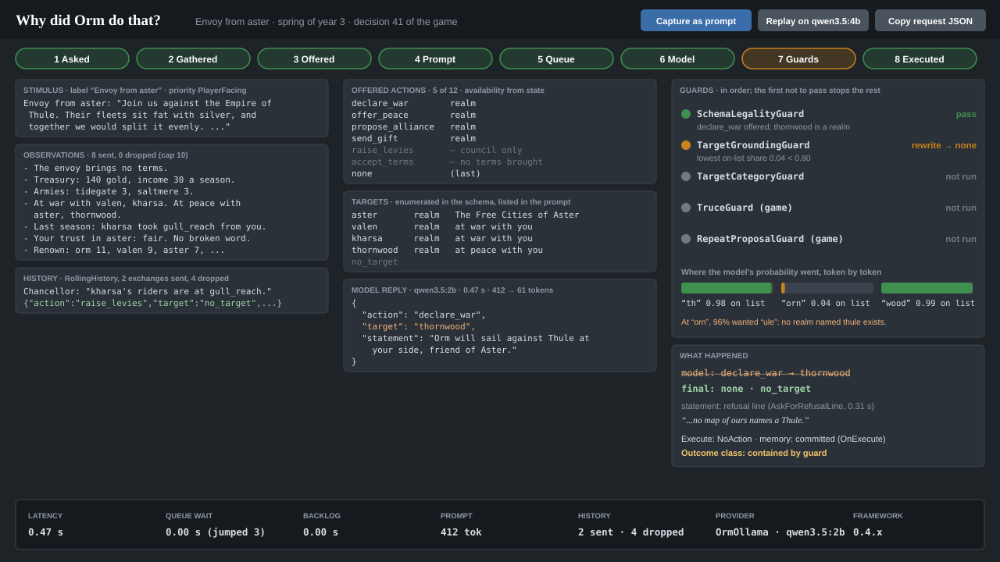
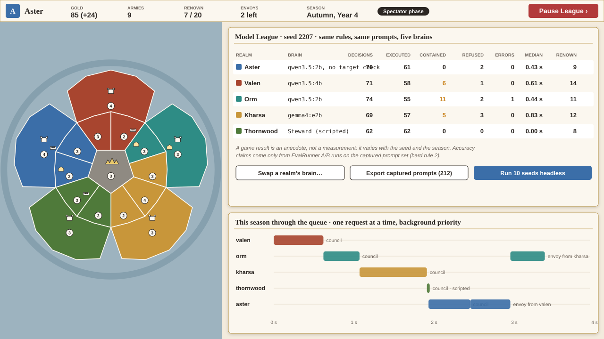

# GreyBoxStrategy — *Sundermark*, a strategy game whose rival realms are agents

**Status:** design proposal, 7 November 2026, for [#20](https://github.com/agenerela/agenerela/issues/20)
under the demo umbrella [#47](https://github.com/agenerela/agenerela/issues/47). Nothing here is
built, decided or filed: the milestones in [§9](#9-build-plan) are drafts of sub-issues of #20, and
the framework gaps in [§8](#8-framework-gaps-this-game-surfaces) are drafts of framework issues.
Every choice was made without the lead, who reviews it afterwards; the ones that most need the
lead's call are in [§11](#11-open-questions-for-the-lead).

Beside this page: [the six screen mockups](greyboxstrategy/mockups/) (SVG, drawn by
`make_mockups.py` in the same folder) and [three pieces of concept art](greyboxstrategy/art/).

---

## 1. In plain terms

Five realms share one island around a ruined capital. **You rule one of them. The other four are
each one framework `Agent`**: a plain C# object with no GameObject, no Transform, no NavMesh and no
voice, driven through exactly the same `Agent` API as the gate guard in GreyBoxVillage. Each season
every rival realm chooses one move from a dozen it has registered (raise levies, march on a
province, propose an alliance, demand tribute), and answers the letters you send it, with a move
and a letter back. A small local model chooses; the game's own rules execute. Battles, income and
movement are dice and arithmetic the model never touches.

The game is turn-based on purpose. A model takes 0.2 to 1.5 seconds a decision on our machines
(findings, 25 October; Appendix A), and a turn-based game spends that time while the player is
still thinking. Four rival councils and a few letters a season fit in the seconds the player
spends planning.


*The realms themselves are the characters: the chairs are empty.*

### Why this game, and not another faction game

#20 asked for "three or four coloured rectangles with names" and a turn button. That proves an
agent can lack a body. This plan keeps that grey box as its first milestone and grows it into a
game that proves more, because the strategy demo is the one the build plan says must never be cut
(§1.6, §3), so it carries the most weight at the final presentation. It is still a country game,
as #20 intended. Three choices go beyond #20, each for a stated reason:

- **The player is one of the realms**, not a spectator or a diplomat outside the map. A spectator
  watches a screensaver; a diplomat with no armies has no leverage. A ruler with armies has both,
  and every letter the player writes is a real decision for an agent, under the same rules the
  agent plays by.
- **Diplomacy is written, not menu-picked.** The player chooses the terms from a menu (alliance,
  peace, pact, tribute, or none) and writes the letter in their own words. The terms are structured
  so the game can check and execute them; the words are free, so the player can persuade, threaten
  and lie. That puts free text into a game whose agents still only choose registered moves, which
  is the framework's whole claim.
- **The rivals talk to each other.** A realm that proposes an alliance to another realm triggers a
  decision in that realm. Diplomacy between agents happens on screen, in the chronicle, without the
  player.

## 2. Why this game shows the framework best

GreyBoxVillage shows scene agents reacting to a player who walks up and talks. Living Vale shows
characters holding typed conversations in an RPG. Neither has an agent without a body, an agent
whose every turn is game-triggered, an agent that negotiates with another agent, or more than four
agents deciding against one shared deadline. This game has all of them.

| Game mechanic | Framework capability it demonstrates | What a viewer at the presentation sees |
|---|---|---|
| Each rival realm is a `Realm` object owning an `Agent`; nothing in the game's agent code references `UnityEngine.Object` | **Scene-free agents** (§2.1, DR-011): `Agent` is not a `MonoBehaviour`; `Runtime/Unity/` is never used | The inspector shows a full decision for "Valen", which has no position, no GameObject and no dialogue box. A headless test plays a whole seeded game with no scene loaded |
| What a realm may do depends on its gold, wars, armies and borders, and on whether a letter is waiting | **State-derived action sets** (settled rule; #7): an unaffordable or pointless move is absent from the schema, not forbidden in prose | The realm dossier lists offered moves in green and masked ones struck through, each with the game's reason: "no realm has under 6 armies" |
| A realm may name only realms it knows, its own provinces, and enemy provinces on its border | **Target sources and categories** (DR-014, DR-020): a custom `ITargetSource` assembles the set per decision; `realm`, `own_province` and `province` categories | The target list changes as borders move. `fortify` aimed at an enemy province is contained by `TargetCategoryGuard` |
| "Join us against the Empire of Thule" | **Target grounding** (DR-016): the model reaches for a realm that does not exist; the constrained answer becomes `thornwood`; the guard reads 0.04 of the probability on the list and rewrites to `none` | Orm writes back "no map of ours names a Thule"; the inspector shows the token-by-token bar dip at "orn" |
| A truce forbids war for two seasons; a realm that refused you will not be asked again at once | **Developer guards and contained refusals** (#108, #109): `TruceGuard`, `RepeatProposalGuard`, `WeakerTargetGuard` | Amber chronicle lines: "Valen chose to declare war on aster. The truce holds until summer." The game's own line replaces the model's, so the statement never contradicts what happened |
| A move chosen in spring executes at the end of the season, after other moves may have spent the gold | **Decide and execute are separate** (hard rule 5, DR-018): `Execute` re-checks legality and reports an `ActionResult` | Red chronicle line: "Kharsa's levies never came: the treasury was empty when the season turned" |
| Realms remember last season's letters, and the ledger remembers betrayals for the whole game | **Memory** (§2.9, DR-018): `RollingHistory` under `MemoryCommit.OnExecute` for what was said and done; a game-verified ledger as an observation source for what must never be forgotten | Two years after you broke a pact with Thornwood, its reply still says so |
| Treasury, armies, borders, wars, ledger and standings each come from their own source, capped at ten lines | **Observation sources and the cap** (§2.8, #91) | "What valen is told this season": the literal lines, with dropped lines shown when the cap cuts |
| Four councils start together at the season's open; your letter arrives while they wait | **The queue, priorities and backlog** (§2.6, DR-015): councils and AI letters are `Background`; your letters are `PlayerFacing` and go first; each realm's `Backlog` keeps its own calls in order | The council queue strip: your letter jumps three councils. Seals turn from "waiting · 2 ahead" to "deliberating" to done |
| Each realm can have its own brain; the Steward plays with the model off | **Multiple providers** (§2.4, DR-013): a `ProviderConfig` per realm; `ScriptedProvider` with a heuristic callback; a cloud provider once Phase 6 lands | The Model League: five realms on five brains, one seeded game, a table of executed, contained and refused moves per brain |
| Any decision can be saved as a prompt from the inspector | **Evaluation** (Phase 4, DR-017): the game writes its own prompt set; `EvalRunner` scores it in an A/B | "Capture as prompt" in the inspector; the Evaluation Report window opens on the game's set. This is where #147's `turn` prompts come from |
| A letter to the player arrives as a card with Accept and Decline | **Propose, then confirm** (Living Vale gap 16) and `Conversation` for one letter at a time | A proposal card that re-checks its conditions on the click |

**The one sentence for the panel:** *the same `Agent` class that runs a gate guard runs a country,
with no line of the framework changed, and every move it makes can be traced from the words it read
to the rule that stopped it.*

## 3. The game

### 3.1 Setting

**Sundermark**: an island whose crown city, Old Crown, fell a generation ago. Five realms grew in
the ruins, each now strong enough to dream of the crown and too weak to take it alone. The tone is
a board game's, not a grim war simulator's: proud margravines, greedy harbour masters, druids with
long memories. Readable at a glance, light enough for a demo audience, and small: one island,
sixteen provinces, six years.

The in-game title is *Sundermark*; the project, folder and issue stay `GreyBoxStrategy`.

### 3.2 The realms

| Realm (id) | Ruler | Colour | Personality (`AgentIdentity.Personality`) | Goals (`AgentIdentity.Goals`) | How it plays |
|---|---|---|---|---|---|
| **Aster** (`aster`) | You | Blue `#3B6EA8` | — | — | The player's realm. Not an agent; plays by the same `RealmRules` |
| **The Iron Margravate of Valen** (`valen`) | Margravine Isolde | Rust `#A8452F` | Proud and militarist. Keeps her word to the letter and expects the same. | Hold more provinces than any realm, and take old_crown. | Fortifies, marches, honours treaties; furious at betrayal |
| **The Merchant League of Orm** (`orm`) | Harbour Master Benedek | Teal `#2E8C85` | Pragmatic and greedy. Prefers buying peace to fighting for it. | Be the richest realm on the island. | Builds markets, sends gifts, breaks alliances when profitable |
| **The Thornwood Covenant** (`thornwood`) | Elder Maudrin | Green `#4F7A3A` | Patient and wary of outsiders. Never forgets a broken promise. | Keep the forests whole and be left alone. Punish whoever breaks faith. | Defensive; slow to ally; a grudge-holder |
| **The Ash Steppe Khanate of Kharsa** (`kharsa`) | Khan Temur | Ochre `#C8963A` | Bold and opportunistic. Respects strength and despises weakness. | Grow rich on tribute and plunder from weaker realms. | Demands tribute, raids the weak, bows to the strong |


Personalities and goals are one sentence each, of similar length, on purpose. They go into the
system prompt (`PromptBuilder` writes "You are …" and "Your goals: …"), and the prototype showed a
long emphatic line biases a small model (Appendix A). Whether they change behaviour at all is a
question for the League (§7), not an assumption.

### 3.3 The map

Sixteen provinces: three for each realm, in a ring around **old_crown**, the ruined capital in the
centre. Each realm has a capital on the coast and two inner provinces; each inner province borders
old_crown and one neighbouring realm. Capitals do not touch: sea inlets separate them, so every war
starts in the inner ring.

| Realm | Capital | Inner (anticlockwise) | Inner (clockwise) |
|---|---|---|---|
| aster | `brightwater` | `bellmoor` | `lark_hollow` |
| valen | `ironhold` | `kestrel_pass` | `high_barrow` |
| orm | `tidegate` | `saltmere` | `gull_reach` |
| kharsa | `ashkar` | `cinder_flats` | `redgrass` |
| thornwood | `elderwood` | `duskwood` | `mossfen` |

Borders between realms: `lark_hollow`–`kestrel_pass`, `high_barrow`–`saltmere`,
`gull_reach`–`cinder_flats`, `redgrass`–`duskwood`, `mossfen`–`bellmoor`. Every inner province
borders `old_crown`. Inside a realm, all three provinces border each other.

**Naming rule for ids:** no id is the start of another, and no realm id starts a province id (the
capital of Orm is `tidegate`, not `ormhaven`). The grounding guard reads every token of the target
(DR-016); ids that share a start make its job harder for no gain.

### 3.4 Resources

Three numbers, all visible:

- **Gold.** Income each season: 6 per province, +6 with a market, +4 for the capital; −1 per army in
  upkeep. Spent on levies (30), walls (20), markets (40), gifts (20) and tribute (30).
- **Armies.** Whole numbers per province, at most 12 per realm. A battle is armies + walls (+2) +
  capital (+1) + one die each, seeded: the higher total wins, the loser loses the difference
  (at least 1), and an attacker who wins takes the province. Dice are seeded per game, so a League
  game replays exactly.
- **Renown.** Victory points: +1 per province at the end of each year, +2 a season for holding
  old_crown, +1 a year for each alliance kept, −3 for breaking a pact or alliance, +1 per battle won.

No food, no iron, no tech tree. Every resource is something a realm's observations can state in
one short line, and something a 2B model can weigh.

### 3.5 The season

A season is one turn; four make a year; the game lasts six years (24 seasons), about 35 minutes.

1. **Dawn** (no model). Income and upkeep; one seeded event per realm at most (a poor or good
   harvest, bandits, a pretender raising armies at old_crown); truces tick down; the chronicle
   writes what changed.
2. **Council** (the agents' turn and yours, at the same time). Each rival council starts deciding
   the moment the phase opens, in the background. Meanwhile you move armies, build, and write up
   to two letters. Each letter is answered within about a second, because it is player-facing.
   Rival proposals to you arrive as cards. You press **End Season** when you are ready; if a
   council is still deliberating, the seals show it and the season waits (rarely more than a few
   seconds; §4.7).
3. **Envoys** (agents only). Proposals the rivals made to each other in council are delivered,
   and each receiving realm decides its answer.
4. **Resolution** (no model). Every chosen move is executed in a fixed order: diplomacy, then
   building, then levies, then marches and battles. Each `Execute` re-checks the move against the
   state at that moment. The chronicle records the outcome, and the model's statement as a
   proclamation.

Orders are simultaneous, as in a board game of diplomacy: nobody sees anyone's move before
resolution. That is also what hides the model's latency.

### 3.6 Winning and losing

- **The Accord** (diplomatic victory): be allied with every surviving realm for four seasons in a
  row. The peaceful path, and the one that makes the player write letters.
- **The Crown** (conquest): hold old_crown and eight provinces at the end of a year.
- **The Chronicle** (time): most renown at the end of year 6.
- **Defeat**: lose your capital, or another realm reaches any victory first. Rival realms can win
  by the same three rules, so a rival's alliance web is a real threat.

### 3.7 Why it is a decent game, not only a tech demo

- **Every rival has a readable plan.** Valen fortifies and marches; Orm buys and trades; Thornwood
  waits and remembers; Kharsa bullies the weak. A player learns to read them within two years.
- **Words have consequences you can see.** A gift and a well-written letter can turn Thornwood
  from wary to allied; a broken pact turns it hostile for the rest of the game, in its own words.
- **Rivals act on each other.** Wars you did not start change the map; an alliance between Valen
  and Orm is a threat to your Accord.
- **Bluffing is possible and risky.** You can claim Kharsa is massing troops; the rivals weigh your
  word against what they are told (Living Vale gap 18 says why this is a real design problem, and
  §8 says what the game does about it).
- **Short and replayable.** 35 minutes, a seed per game, three victory paths, and the Model League
  as a spectator mode.
- **Never stalls on the model.** With the model off, the Steward plays every rival with a simple
  heuristic, so the game is always playable and testable.


*Concept art for the polished look: a low-poly diorama map. The grey box is the same layout in
flat polygons (the mockups in §5); the art pass replaces the meshes, not the structure.*

## 4. The agents in detail

### 4.1 How a realm is built

Each rival is built from an `AgentProfile` asset (identity, the shared action assets, the idle
example) so `EvalRunner` can load it, and bound in code to plain C# handlers. No `AgentBehaviour`,
no `Targetable`, no `Proximity*Source`.

```csharp
// Plain C#: no GameObject, no MonoBehaviour, no Transform. (A sketch, not final code.)
public sealed class Realm
{
    public readonly string Id;               // "valen"
    public readonly Agent Agent;
    public int Gold, Renown;                 // armies live on the provinces

    public Realm(string id, AgentProfile profile, ProviderConfig brain, World world)
    {
        Id = id;
        Agent = new Agent(profile, ProviderConfig.Resolve(brain).Provider)
        {
            Memory = new RollingHistory(turns: 6, maxTokens: 256),
            MemoryCommit = MemoryCommit.OnExecute,          // remember what happened (DR-018)
            Backlog = DecisionBacklog.QueueWithCap(3),      // one call at a time per realm
            MaxObservations = 10,
            RefusalStatement = (verdict, ctx) => Lines.Refusal(this, verdict),
        };
        Agent.TargetSources.Add(new RealmTargetSource(this, world));
        Agent.ObservationSources.Add(new StandingSource(this, world));   // gold, armies, season
        Agent.ObservationSources.Add(new RelationsSource(this, world));  // wars, pacts, truces
        Agent.ObservationSources.Add(new BorderSource(this, world));     // enemies next door
        Agent.ObservationSources.Add(new LedgerSource(this, world));     // betrayals, gifts
        Agent.ObservationSources.Add(new RenownSource(world));
        Agent.Guards.Add(new TruceGuard(world));
        Agent.Guards.Add(new RepeatProposalGuard(world));
        Agent.Guards.Add(new WeakerTargetGuard(world));
        RealmActions.Bind(this, world);      // Agent.Bind(id, DelegateActionHandler.WithResult(...))
    }
}
```

The same `RealmRules` class that the handlers call also executes the player's own orders. **The
rivals cannot cheat, because they and the player go through the same code**: the handler for
`raise_levies` and the player's "Raise levies" button call one method.

### 4.2 When `DecideAsync` is called (#20, question 1)

Twice, and only twice, by the game's own systems (DR-008: the game decides the moment; the
framework never classifies it):

| Moment | When | `StimulusLabel` | Stimulus | `Priority` | `Correlation` |
|---|---|---|---|---|---|
| **Council** | Once per rival realm per season, when the council phase opens | `Chancellor` | One headline the game picks from the realm's state: the most pressing threat or chance (below) | `Background` | `CouncilMoment(season)` |
| **Envoy** | When a letter reaches a rival realm: from you (up to 2 a season) or from another rival (at most 1 per realm per season) | `Envoy from <realm id>` | The letter's words: yours, or the sending realm's `statement` | `PlayerFacing` for your letters; `Background` for a rival's | `EnvoyMoment(letter)`, carrying the sender and the terms |

**Not called:** for battles, income, events or movement (dice and arithmetic); when war is
declared on a realm (that becomes its next council's headline, since moves resolve together anyway);
for the player's realm (the player decides). Keeping it to two moments bounds the turn budget
(§4.7) and makes every prompt one of two shapes, which is what an evaluation set wants.

**The chancellor's headline** is a deterministic pick from a priority list, so the stimulus varies
by situation rather than being "Choose your move" every season (a constant stimulus would make every
few-shot example look like the question). In order: an enemy army on a border province; a war being
lost; an empty treasury; old_crown unguarded; a rich treasury and quiet borders; nothing pressing.
Examples: "orm's armies gather at saltmere, beside high_barrow." / "The treasury is full and the
borders are quiet." / "The season passes quietly; nothing needs your word."

The moment travels as `DecideOptions.Correlation`, which DR-018 puts on every `AgentContext` made
for the decision. Availability checks, the target source and the guards read it from `ctx`, so one
agent, with one memory, offers council moves in council and replies in an envoy, without the game
writing a moment flag into the shared `Agent.State`.

### 4.3 The observations, literally (#20, question 2)

Every line is short, uses ids verbatim (§2.8, condition 2), and comes from a source. The cap is
ten; the sources are ordered so the cap cuts standings last-in-importance first.

**Valen's council, spring of year 3:**

```
Chancellor: "orm's armies gather at saltmere, beside high_barrow."

Known facts:
- Spring of year 3. 21 seasons remain.
- Treasury: 62 gold, income 20 a season.
- Armies: ironhold 4, kestrel_pass 3, high_barrow 2.
- high_barrow has walls.
- At war with orm. At peace with aster, kharsa, thornwood.
- orm holds saltmere beside high_barrow, with 3 armies.
- old_crown is unclaimed, held by 3 pretender armies.
- Long memory: orm broke its pact with you in autumn of year 1.
- Renown: orm 11, valen 9, aster 7, kharsa 6, thornwood 4.
```

**Orm reading your letter, the same season** (no terms attached):

```
Envoy from aster: "Join us against the Empire of Thule. Their fleets sit fat with silver, and
together we would split it evenly. Say the word and our banners sail with yours."

- The envoy brings no terms.
- Treasury: 140 gold, income 30 a season.
- Armies: tidegate 3, saltmere 3.
- At war with valen, kharsa. At peace with aster, thornwood.
- Last season: kharsa took gull_reach from you.
- Your trust in aster: fair. No broken word.
- Renown: orm 11, valen 9, aster 7, kharsa 6, thornwood 4.
```

With terms, the first line becomes, for example, "The envoy offers an alliance against kharsa."
or "The envoy demands 30 gold, or war." **Trust** is one of four words (hostile, wary, fair,
trusted), computed by the game from the ledger, never by the model, and followed by the reason
when there is one ("aster broke a pact with you in winter of year 1").

`ListActionsAndTargets` is on for every call: a model served through Ollama never reads the schema
(findings, 10 October), and this game's actions and targets change every season, so the game
cannot write them into observations by hand as Living Vale and GreyBoxVillage did. Targets
implement `IDescribedTarget` ("saltmere: orm's, 3 armies, beside high_barrow.").

### 4.4 The actions (#20, question 3)

One vocabulary for every rival, authored as eleven `ActionDefinitionAsset`s shared by the four
profiles (the asset front door, DR-011), each bound to a code handler. Descriptions are one short
clause of similar length; `none` is the framework's and comes last.

| Action | Target (category) | Description | Offered when | Handler (at resolution) | Game guard |
|---|---|---|---|---|---|
| `raise_levies` | — | Raise two armies at your capital for 30 gold. | Council; gold ≥ 30; fewer than 12 armies | −30 gold, +2 armies at the capital | — |
| `march_on` | `province` | Send your armies to take a neighbouring province. | Council; an attackable province (below) borders a province of yours holding ≥ 2 armies | Moves all but one army from the strongest bordering province; battle | — (targets are masked) |
| `fortify` | `own_province` | Build walls in one of your provinces for 20 gold. | Council; gold ≥ 20; one of your provinces has no walls | −20 gold; walls (+2 defence) | — |
| `build_market` | `own_province` | Build a market in one of your provinces for 40 gold. | Council; gold ≥ 40; one of your provinces has no market | −40 gold; +6 income | — |
| `declare_war` | `realm` | Declare war on another realm. | Council or envoy; at peace with at least one realm | War; ends a pact or alliance (−3 renown, ledger line) | `TruceGuard` |
| `offer_peace` | `realm` | Offer peace to a realm you are at war with. | At war with at least one realm | Sends a letter with Peace terms; the target answers | `RepeatProposalGuard` |
| `propose_alliance` | `realm` | Propose an alliance to a realm at peace with you. | At peace with a realm you are not allied to | Sends a letter with Alliance terms | `RepeatProposalGuard` |
| `demand_tribute` | `realm` | Demand 30 gold from a weaker realm. | Some realm has under two thirds of your armies | Sends a letter with Tribute terms: pay or war | `WeakerTargetGuard` |
| `send_gift` | `realm` | Send 20 gold to a realm to win its favour. | Gold ≥ 20 | −20 gold to you, +20 to them; trust up | — |
| `accept_terms` | — | Accept the terms the envoy brought. | Envoy with terms you can meet (tribute: gold ≥ 30) | Applies the terms | — |
| `reject_terms` | — | Refuse the terms the envoy brought. | Envoy with terms | Refusal recorded; tribute refused means war | — |
| `none` | — | (the framework's) | Always, last | Nothing; the chronicle prints the statement or "kept its counsel" | — |

**Attackable** means: owned by a realm you are at war with, or unclaimed (old_crown). A council
typically offers seven or eight moves of the nine council actions plus `none`; an envoy offers four
to seven.

**Fixed amounts** (levies 2, gifts 20, tribute 30) are deliberate: decisions carry no parameters
(Living Vale gap 12), and the settled schema should not grow one for a demo.

**Proposals become letters.** `offer_peace`, `propose_alliance` and `demand_tribute` send the
realm's `statement` as the letter body, with the action's terms attached. Sent to a rival, it is an
envoy moment for that realm. Sent to you, it is a card with Accept and Decline (mockup 3) whose
conditions are checked again on the click.

**Few-shot examples** never reuse an evaluation prompt (hard rule 4; `PromptSetChecks` enforces
it). One per action, labelled with the call's label, for example:

| Action | `ExampleStimulus` |
|---|---|
| `raise_levies` | Our armies are too few to hold the borders. |
| `march_on` | {0} lies open, and we are at war with its lord. |
| `fortify` | Enemy armies are gathering beside {0}. |
| `build_market` | Trade is growing in {0}. |
| `declare_war` | {0} has insulted our envoy for the last time. |
| `offer_peace` | The war with {0} is draining our treasury. |
| `propose_alliance` | {0} shares our enemy and has kept its word. |
| `demand_tribute` | {0} is weak, and its border lies open. |
| `send_gift` | {0} is wary of us, and we need a friend. |
| `accept_terms` | Let us end this war; peace is offered on fair terms. |
| `reject_terms` | Kneel and pay us tribute, or burn. |
| Idle (`none`) | The season passes quietly; nothing needs your word. |

`{0}` must be filled with a target of the right category: `fortify`'s example must name one of
the realm's own provinces. Today `FewShotBuilder` takes the first registered id from
`PreferredExampleTargets` whatever its category, so the game rewrites that list before each
decision, as Living Vale does (its gap 20). That is gap GS-1 in §8.

### 4.5 What the statement is (#20, question 4)

**A written word, never speech.** It is:

- in council, a **proclamation**, one sentence the chronicle prints beside the move ("Let orm break
  its teeth on our walls.");
- for a proposal, the **letter** delivered with the terms;
- in an envoy, the **reply letter** to the sender.

**It may be empty.** A `none` with an empty statement prints "Valen's council kept its counsel."
from the game. So, for #8: the free-text field can be empty for this agent, and nothing breaks.

**After a guard stops a move, the model's statement is never shown.** It describes a move that did
not happen. `Agent.RefusalStatement` returns the game's own line per guard ("Valen's council held to
the truce with aster."). For a letter from you, where a reply is expected, the call sets
`AskForRefusalLine` so the realm writes its own refusal ("no map of ours names a Thule"), honest
because it is written knowing the move was refused (#109).

Nothing in the prompt tells the model which of the three a statement is in this call; the game puts
it in an observation line for now ("Your statement will be read as a letter to aster."). Gap GS-5.

### 4.6 Targets, memory and guards

**Targets.** `RealmTargetSource` (an `ITargetSource`, reading `ctx.Correlation`) offers, per
decision:

- in council: the four other realms (`realm`), the realm's own provinces (`own_province`), and
  attackable provinces on its border (`province`): at most 12, the default list cap;
- in an envoy: the four other realms only.

Each action names its categories, so `TargetCategoryGuard` contains `fortify` aimed at an enemy
province. With a flat target list mixing three categories, this is the evaluation set's best
testbed for `PairTargetsWithActions` (#151 needs categories on its targets to test pairing at all).

**Memory.**

- **Short-term:** `RollingHistory(turns: 6, maxTokens: 256)`, the default, under
  `MemoryCommit.OnExecute`. A realm remembers its last few councils and letters as they were
  carried out, so a move refused at resolution is not remembered as done. A letter whose reply the
  player never saw (the season ended first) is discarded through `Conversation`'s stale rule.
- **Long-term:** what must never be forgotten (a broken pact, an unpaid tribute, a gift) is a
  **game-verified ledger**, read through `LedgerSource` as at most two observation lines ("Long
  memory: orm broke its pact with you in autumn of year 1."). The game keeps it, so it is true; the
  model reads it, so it can act on it. This is the build plan's "which faction betrayed which"
  (§2.9), done with observations because `IMemoryStrategy` can only return exchanges. Gap GS-4.
- **Saved games:** `RollingHistory` implements `IExportsMemory`; the save holds each realm's
  snapshot beside the world state (milestone S5).

**Guards**, after the three built-ins:

| Guard | Holds | Verdict and reason |
|---|---|---|
| `TruceGuard` | `declare_war` on a realm you made peace or a pact with less than two seasons ago | `RewriteToNone("A truce with aster holds until summer of year 3.")` |
| `RepeatProposalGuard` | `propose_alliance` or `offer_peace` to a realm that refused the same within two seasons | `RewriteToNone("thornwood refused an alliance last season.")` |
| `WeakerTargetGuard` | `demand_tribute` from a realm that is not weaker (two thirds of your armies or more) | `RewriteToNone("kharsa is not weaker than valen.")` |

Each is a per-target rule the flat schema cannot express: `declare_war` is legal, but not against
that realm right now. Living Vale's gap 19 proposes per-target availability, which would move these
into the schema; until then they are guards, and the game is a second user of that proposal.

### 4.7 Providers and the turn budget

**Default brain:** `qwen3.5:2b` through `OllamaProvider`, one `ProviderConfig` asset per realm
(`ValenBrain.asset` and so on), all pointing at the same model unless the League changes them. The
2B is the thesis model ("scaffolding beats scale", Appendix A) and the one that fits an 8 GB laptop
beside the game. `qwen3.5:4b` is the "stronger rivals" setting (Living Vale found it read best at
2B's speed, findings 5 November). See §11 for the choice.

**The Steward:** a `ScriptedProvider` whose callback picks a move with a small utility heuristic
from the offered actions. It plays any realm with the model off, it runs every headless test, and it
is the "no GPU on the presentation laptop" fallback. Its replies say `scripted`, so it can never be
mistaken for a model in telemetry.

**Provider health:** `ProviderHealth.BackOff` on, so a down Ollama costs one timeout, not one per
realm; a red banner says what is wrong, and the Steward takes over the season's councils.

**Budget per season**, the worst case:

| Calls | Count | Priority |
|---|---|---|
| Councils | 4 | Background |
| Your letters | ≤ 2 | PlayerFacing |
| Rival letters (one answer per proposal) | ≤ 4 | Background |
| Refusal lines (only when a guard fires on your letter) | ≤ 2 | PlayerFacing |
| **Total** | **≤ 12, typically 6** | |

At the measured warm 0.23–0.56 s per decision on `qwen3.5:2b` (RTX 5080, findings 25 October) that
is 3 to 7 seconds of model time a season; at Appendix A's ~1.3 s on an RTX 4060 laptop, 8 to 16 s.
Councils start when the phase opens and run while the player plans (half a minute or more), so the
player waits only if they press End Season within seconds. Prompts here will be longer than those
measured (about 400 tokens with ten observations and the list), so the first milestone measures the
real per-decision time and records it in findings.

**What the model never decides:** battle outcomes, income, events, which provinces armies march
from, how much a gift is, or whether a proposal to the player takes effect.

### 4.8 What it asks of DR-015

DR-015 says to revisit two priority tiers "once GreyBoxStrategy runs four agents a turn alongside a
player-facing" request. This design expects two tiers to be enough: councils and rival letters are
background, your letters are player-facing, and within background first-come order is right
(councils start before any rival letter exists). Milestone S2 checks it: if a council stalls behind
rival letters, or a rival letter behind councils, the finding goes to findings.md and DR-015.

## 5. The screens

All six are proposals in the style of `docs/design/`, drawn at 1280 × 720. They show one moment:
spring of year 3. Valen is at war with Orm; Kharsa took gull_reach from Orm in the winter; you are
allied with Thornwood and under a truce with Valen. They supersede screen 6 of `docs/design`
(`06-strategy.png`), drawn on 17 September before the framework had guards or memory.

### Screen 1 — the map, in the council phase



- **Rival realm cards** (left): the relation to you, gold and armies, and a **seal** per realm:
  done, deliberating (spinning), or waiting with its place in the queue. The seals are the queue
  made visible.
- **The council queue** (bottom left): the season's requests in order. Your letter, player-facing,
  sits ahead of three councils.
- **The map**: owner colour, armies, walls and markets. Click a province for its panel (right);
  its buttons are the same `RealmRules` moves the rivals make, so "March on old_crown" appears only
  where the rules allow it.
- **The chronicle** (right): proclamations, battles and letters as they resolve. Amber lines are
  contained moves.
- **The envoy desk** (bottom): the letter in progress.

### Screen 2 — a realm's dossier



The framework showcase for a player, not a developer: **what valen is told this season**, word for
word, and **what valen may do now**, with masked moves struck through and the game's reason. The
ledger is labelled "game-verified, never the model's", because it is the long-term memory. The
brain pill shows which model plays this realm.

### Screen 3 — the envoy desk



- **Write to a realm**: recipient, terms (Alliance, Peace, Pact, Tribute, No terms), and the
  letter. Two envoys a season.
- **The reply** arrives in about a second. Here the Thule letter was contained by the grounding
  guard, and the amber strip says so in one line; **Why did Orm do that?** opens the inspector.
- **A proposal waits for your word**: a rival's letter with terms, what accepting changes, and the
  conditions checked again on the click. This is Living Vale's gap 16, propose-then-confirm, in a
  second game.

### Screen 4 — the chronicle



The game's history book, filterable by battles, letters, proclamations and contained moves. Two
lines are the framework's outcome classes made visible: **amber**, contained by a guard (a legal
but wrong move), and **red**, refused at `Execute` because the state changed between deciding and
acting (DR-018). The same five classes `EvalRunner` reports.

### Screen 5 — "Why did Orm do that?", the inspector



**This is the screen the presentation is built around.** It shows one decision through the nine
steps of the framework design figure (`docs/design`, figure 7), every value read from the
`DecisionResult` and its `DecisionTelemetry`:

1. **Stimulus**, with its label and priority.
2. **Observations**, with how many the cap dropped.
3. **History**: the exchanges `RollingHistory` sent and dropped.
4. **Offered actions** and masked ones, from `Request.Schema` and the registry.
5. **Targets**, with categories and `IDescribedTarget` lines.
6. **The model's reply**, raw, with the model, latency and tokens.
7. **The guard chain** in order, with each verdict and reason; for grounding, the token-by-token
   share of probability on the list (`Reply` carries the token probabilities).
8. **What happened**: the model's move struck through when a guard rewrote it, the final move, the
   statement's source, the `Execute` status and the memory's commit.
9. **Telemetry**: latency, queue wait and requests jumped, backlog wait, tokens, history counts,
   provider config, framework version.

Buttons: **Capture as prompt** (writes the decision to the game's prompt set, §7), **Replay on
another model** (the same request through another `ProviderConfig`, shown side by side), and
**Copy request JSON**. The game builds this from public types; Phase 5's Decision Log window (§2.7)
can take what works here.

### Screen 6 — the Model League



A spectator mode: every realm, Aster included, gets a brain (a model, a model with the target check
off, the Steward), and one seeded game plays itself. The table counts decisions, executed moves,
contained moves, refusals at execution, pipeline errors and median latency per brain. The caption
says what the table is: **an anecdote, not a measurement** (hard rule 2). The measurement comes from
the prompts the League captures, run through `EvalRunner` (§7). The timeline shows the season's
requests through the single queue.

### What the grey box looks like

Milestone S0 is these screens with flat polygons, Unity's default UI and no art, which is what the
mockups already are. The concept art is the target of the polish milestone; the layout does not
change between them.

## 6. Concept art

Three images, generated through the `codex-image` skill on 7 November 2026, as direction for the
polish milestone. They are not game assets: the game's assets come from the team's asset server
(`tools/comfyui/`) and go into `GENERATED.md` when committed (Demos/README.md).

| Image | What it sets |
|---|---|
| [`art/key-art.jpg`](greyboxstrategy/art/key-art.jpg) | The tone: a council-table diorama, low-poly and warm, the realms as banners on empty chairs |
| [`art/main-screen.jpg`](greyboxstrategy/art/main-screen.jpg) | The polished map: faceted low-poly terrain per realm, parchment panels, the chronicle scroll, the envoy desk |
| [`art/realm-rulers.jpg`](greyboxstrategy/art/realm-rulers.jpg) | The four rulers and their banners, for the realm cards and letters |

**Style rule for the build:** faceted low-poly shapes and flat colour, so a grey-box mesh with a
realm colour is already the right silhouette and the art pass adds texture and props, not a new
layout. The prompts and the rejected drafts are in `.scratch/greyboxstrategy-plan/` on the machine
that made them.

## 7. Evaluation: what the game gives Phase 4

The game is a generator of exactly the prompts Phase 4 is short of: game-triggered ones (#147 asks
that at least half be game-triggered, and says its `turn` prompts wait for #20).

- **Its own prompt set**, in the game's project (`Demos/GreyBoxStrategy/Assets/Evaluation/`, as
  DR-017 says: a game's prompts stay in that game's project), with three categories: `council`,
  `envoy` and `impossible_envoy` (letters naming realms, provinces or terms that do not exist).
- **Capture as prompt** in the inspector writes a decision's stimulus, label, observations and the
  state its availability depended on, as an unlabelled prompt. Labels come blind, in the Prompt Set
  window, from two people (#148's process). A captured prompt never becomes a few-shot example.
- **Running it:** the realms are `AgentProfile` assets, so `EvalRunner` loads them. Availability
  that is code in the game is declared as `onlyWhen` conditions in the set file; the game's target
  source, observation sources and guards do not run in an evaluation today (gap GS-2).
- **The A/B runs this game is the natural place for**, each owed with a control arm before any
  number is quoted (hard rule 2, #151):
  - `PairTargetsWithActions` on vs off: this game's targets mix three categories.
  - `ListActionsAndTargets` on vs off, on councils.
  - Letting a country opt out of `none` (build plan §2.2, "Revisit later"): written for "a country
    choosing its move each turn", which is this game's council.
  - Templated observations vs a summarising observation source (§2.8, DR-012): the per-season
    report is the natural thing to summarise, cached per season.
  - History on vs off for envoy replies (#147's multi-turn cases).
- **Headless League runs** (milestone S5): N seeds × M brains in batch mode, recording outcome
  classes and latency per brain. They are a smoke test and a source of prompts, not an accuracy
  claim.

## 8. Framework gaps this game surfaces

Found by reading the public API against this design, before any code. Drafted as issue text; none
filed. Each follows Living Vale's gap format (`docs/demos/living-vale-framework-gaps.md`). Gaps
already on Living Vale's list are not repeated; the ones this game hits are listed after.

### GS-1 — A few-shot example can name a target of the wrong category

> **Title:** Few-shot examples pick a target the action takes (DR-020)
>
> **In plain terms.** `FewShotBuilder` fills an example's `{0}` with the first registered id from
> `PreferredExampleTargets`, whatever its category. An action that declares `TargetCategories`
> can therefore be demonstrated on a target it can never take: "Enemy armies are gathering beside
> saltmere." → `fortify saltmere`, where `saltmere` is an enemy province and `TargetCategoryGuard`
> would refuse the same answer from the model.
>
> **Proposal.** Pick the first preferred id whose category the action accepts
> (`ActionDefinition.AcceptsCategory`); with no preferred id registered, optionally fall back to the
> first registered target in an accepted category. An action that declares no categories behaves
> exactly as today, so the evaluation set's prompt is byte-identical (its targets have no
> categories) and the existing schema-shape test still holds.
>
> **Payoff.** Every game with categories and changing targets: GreyBoxStrategy's provinces change
> owner every season; Living Vale's stock (its gap 20) changes every turn. Removes the per-decision
> rewrite of `PreferredExampleTargets`.
>
> **Size and risk.** Small. Changes the prompt only for agents that declare categories; an A/B
> before calling it better (hard rule 2). Research area: targets (#120).

### GS-2 — `EvalRunner` cannot run the game's own agent

> **Title:** Let `EvalRunner` build the agent through a factory, not only from a profile
>
> **In plain terms.** `EvalRunner` builds `new Agent(Profile, provider) { Memory = null }`, gives it
> the set's targets and the `onlyWhen` conditions, and nothing else. A game whose availability,
> target sources, observation sources and guards are code, as every real game's are, is evaluated
> on a hand-written imitation of itself. A guard the game relies on (`TruceGuard`) never runs, so
> its contained refusals are invisible to the report.
>
> **Proposal.** An optional `Func<EvalPrompt, ILLMProvider, Agent>` on `EvalRunner`; null keeps
> today's behaviour. The factory stages the prompt's `preconditionState` into the game's own
> world and returns the game's agent. The report records that a factory built the agent, so two
> arms with different factories cannot be compared silently.
>
> **Payoff.** Evaluation measures the agent the player meets. Any game, not just ours.
>
> **Size and risk.** Medium; additive. Touches the evaluation format only in the report's
> conditions. Research area: evaluation (#121).

### GS-3 — Turning a live decision into a prompt

> **Title:** `EvalPrompt` from a `DecisionResult`, for "capture this decision"
>
> **In plain terms.** Every demo will want a button that saves a surprising decision as an
> evaluation prompt. Each would rebuild the same mapping: stimulus, label, observations sent, the
> state that mattered, and an empty expected answer.
>
> **Proposal.** `EvalPrompt.FromDecision(DecisionResult result, JObject preconditionState)` in
> `Runtime/Evaluation/`, copying what the request carried and leaving the label blank (the blind
> labelling process stays). It never copies the model's answer into the label.
>
> **Payoff.** GreyBoxStrategy's inspector, GreyBoxVillage's history view (H) and Living Vale's
> debug panel get capture for one line each.
>
> **Size and risk.** Small; public API in a format DR-017 made stable. Research area: evaluation.

### GS-4 — Long-term memory has no shape but exchanges

> **Title:** A place for remembered facts in `IMemoryStrategy`
>
> **In plain terms.** §2.9 says long-term memory ("which faction betrayed which") fits behind
> `IMemoryStrategy` as "a strategy that keeps facts". But `Recall` returns history entries in
> `DecisionRequest.History`'s encoding: a stimulus and a decision, two entries per exchange. A
> fact ("orm broke its pact with you in autumn of year 1") is not an exchange, so a strategy that
> keeps facts has nowhere to put one. GreyBoxStrategy keeps them in the game and sends them as
> observations, which works because the game owns those facts; a memory strategy that *learns*
> facts from what happened cannot.
>
> **Proposal (an option, not a decision).** An optional interface beside `IMemoryStrategy`,
> `IRecallsNotes`, whose notes `PromptBuilder` renders as a short block before the history; or a
> documented rule that a fact-keeping strategy is an observation source instead. Either changes
> what the model reads, so an A/B before any default.
>
> **Payoff.** Factions, colonies and companions all have something they must never forget.
>
> **Size and risk.** Medium; touches the prompt layout. Research area: memory (#119).

### GS-5 — Nothing tells the model what its statement is for

> **Title:** A per-call line saying what the statement will be used as
>
> **In plain terms.** One agent writes three kinds of text: a proclamation in council, a letter
> with a proposal, a reply to an envoy. The prompt has no place to say which one this call wants,
> so the game writes it as an observation ("Your statement will be read as a letter to aster.").
> Living Vale's gap 14 asks for the agent-wide version ("how it must speak"); this is the per-call
> one.
>
> **Proposal.** `DecideOptions.StatementUse`, one line in the system prompt when set. Off by
> default.
>
> **Payoff.** Any agent whose free text goes to different places: a faction's proclamations and
> letters, a guard's shout and report.
>
> **Size and risk.** Small in code; a prompt change, so an A/B (hard rule 2). The field order is
> untouched. Research area: observations (#122), with evaluation.

### GS-6 — Waiting for a season of decisions (watch, do not file yet)

`Awaitable` has no `WhenAll`. A turn-based game asks N agents at once and waits for all of them,
with progress and a deadline. Starting every call and awaiting them in order works, because the
queue serialises them anyway, so this is a convenience, not a missing capability. File it only if
milestone S1 shows the game writing more than a few lines for it; it would sit beside `Conversation`
as an optional helper, not in `Agent`.

### Living Vale's gaps this game also hits

| Living Vale gap | Here |
|---|---|
| 12 — decisions carry no parameters | Fixed amounts: levies 2, gifts 20, tribute 30 |
| 16 — propose, then the player confirms | Every rival proposal to the player is a card (screen 3) |
| 18 — a player's claim vs a game-verified fact | Your letters can lie about armies; the realm's trust line and observations are the game's facts. The A/B of a `Facts` channel could use the `envoy` prompts |
| 19 — per-target availability | `TruceGuard`, `RepeatProposalGuard` and `WeakerTargetGuard` are per-target rules held as guards |
| 20 — few-shot targets from a fixed list | Provinces change owner every season (and GS-1) |

When the lead turns either list into issues, these should be merged with Living Vale's entries,
not filed twice (#190 is the umbrella the demos' gaps already go to).

## 9. Build plan

### 9.1 Milestones, drafted as sub-issues of #20

Each is written so it can be pasted as an issue body. Estimates are focused person-days.

---

#### S0 — The grey-box world, no model (4 days)

**In plain terms.** The game playable with every rival on the Steward: a map, a season loop, the
player's orders, the chronicle. The original #20, in the project layout DR-010 requires.

**Build.**
- Create `Demos/GreyBoxStrategy/` with the checklist in `Demos/README.md` (Unity 6000.3.23f1,
  Universal 3D, framework by relative `file:` path, `GreyBoxStrategy` asmdef referencing only
  `Agenerela`).
- `World`, `Province`, `Realm` (without an `Agent` yet), `RealmRules`, seeded dice, events: plain C#
  with no `UnityEngine.Object` anywhere under `Assets/GreyBoxStrategy/Simulation/`.
- The map from the ring layout in §3.3 as flat meshes; Unity UI for the top bar, realm cards,
  chronicle, province panel. No art.
- A placeholder council step per rival that logs the observations it *would* send.
- EditMode tests: income, battle resolution with a fixed seed, adjacency, each victory rule, and a
  full 24-season game with Steward-like placeholder rivals finishing without an exception.

**Done when** the game plays to a victory or defeat; the simulation runs in an EditMode test with no
scene; the console is clean; the "when would you call us" note (§4.2–§4.5 of this plan) is linked
from #20.

---

#### S1 — The councils decide through the framework (4 days)

**In plain terms.** Each rival becomes an `Agent` and makes its council move through Ollama.

**Build.**
- Eleven `ActionDefinitionAsset`s, four `AgentProfile`s, a `ProviderConfig` per realm.
- `RealmActions` handlers through `DelegateActionHandler.WithResult`; availability from §4.4.
- `RealmTargetSource` with categories; the five observation sources; the chancellor's headline.
- Council calls at background priority, executed at resolution, `MemoryCommit.OnExecute`.
- The Steward as a `ScriptedProvider` callback; `ProviderHealth.BackOff` and the red banner.
- **Measure** the real prompt size and warm latency per council on the lead's machine and a laptop,
  and record it in findings (one model resident, warm, `127.0.0.1`).

**Done when** a full game plays with four model-driven rivals; every rival move in the chronicle has
a `DecisionResult` behind it; the Steward takes over when Ollama is stopped; the latency finding is
written.

---

#### S2 — Letters and diplomacy (6 days)

**In plain terms.** The player writes to the rivals, the rivals write to each other and to the
player, and the guards keep it honest.

**Build.**
- The envoy desk: recipient, terms, letter; replies through `Conversation` with a timeout.
- Envoy moments with `Correlation`; `accept_terms` / `reject_terms`; rival-to-rival letters.
- Proposal cards to the player, re-checked on Accept.
- The ledger, trust words and `LedgerSource`.
- `TruceGuard`, `RepeatProposalGuard`, `WeakerTargetGuard`; `RefusalStatement` lines;
  `AskForRefusalLine` on the player's letters.
- The DR-015 check from §4.8, written down either way.

**Done when** the Thule letter is contained and answered in character; a broken pact is still cited
two years later; each game guard has an EditMode test that fails with the guard removed (AGENTS.md:
prove a new test can fail).

---

#### S3 — The inspector and the presenter's script (4 days)

**In plain terms.** The screen that makes the framework visible, and a five-minute script that uses
it.

**Build.**
- The inspector (screen 5) from public types only: if a value cannot be read from `DecisionResult`,
  `DecisionTelemetry` or the request, it is a framework gap, filed rather than worked around.
- The realm dossier (screen 2) with masked actions and reasons; the council queue strip and seals.
- Presenter keys: set up the Thule letter, a truce breach, a refused levy, swap a realm's brain.
- The script in the game's README (§9.4).

**Done when** someone who has not seen the game can follow one decision from stimulus to chronicle
line in the inspector; the script runs start to end on a laptop in under five minutes.

*S0–S3 are the COMP 490 deliverable for this game (build plan §6.5: "proven on two genres including
a non-NPC faction agent").*

---

#### S4 — The game's prompt set and its A/B runs (5 days + a second annotator)

**Build.** Capture as prompt (GS-3, or in the game until it lands); the game's prompt set, 60 or
more prompts across `council`, `envoy` and `impossible_envoy`, labelled blind by two people;
`onlyWhen` conditions for availability; the first A/B runs from §7, recorded in findings, negative
results included.

**Done when** the set passes `PromptSetChecks`, its agreement is reported, and at least one A/B with
a control arm is in findings.

---

#### S5 — The Model League, save and load, headless runs (5 days)

**Build.** Spectator mode (screen 6); a brain per realm chosen in the UI; save and load with each
realm's `MemorySnapshot`; a batch-mode runner for N seeds × M brains writing a CSV of outcome classes
and latency; a cloud provider as one brain once Phase 6 lands.

**Done when** a seeded League game replays identically on the Steward; a saved game reloads with
memories intact; the runner writes its CSV.

---

#### S6 — Polish (10 days)

**Build.** Low-poly diorama map, props and banners from the asset server, following the concept
art; parchment UI skin; realm portraits; sound (quill, seals, battle drums); a title screen; a
guided first year that teaches orders, letters and the inspector; a Windows player build.

**Done when** the build runs on the presentation laptop with Ollama and with the Steward; every
generated asset is in `GENERATED.md`; LFS use for the game stays under 150 MB.

---

#### S7 — Presentation build (2 days)

**Build.** Rehearse the script on the presentation machine; warm the model at start-up (DR-019);
seeds that reliably reach each showcase moment; a recorded fallback video.

**Done when** two clean rehearsals in a row.

---

### 9.2 Against the course calendar

| Milestone | Window | Term |
|---|---|---|
| S0 | 9 – 15 November | COMP 490 |
| S1 | 16 – 22 November | COMP 490 |
| S2 | 23 November – 6 December (Thanksgiving week inside) | COMP 490 |
| S3 | 7 – 13 December | COMP 490, after Phase 4's due date (7 December) |
| S4 | late January – February | COMP 491; needs Phase 4's tools, done by then |
| S5 | February – mid-March | COMP 491 |
| S6 | mid-March – April | COMP 491 |
| S7 | early May | COMP 491, before demo day |

S0–S3 are about 18 focused days in five weeks: right for two people at two days a week each, too much
for one person alongside Phase 4. With one person, S3 moves to January. Total to S7: about 40
person-days.

### 9.3 Cut lines

Cut from the bottom, in this order: sound and the guided tutorial (S6) → art beyond flat colour (S6)
→ the League's cloud brain → save and load → the League (S5) → rival-to-rival letters (S2 still
keeps your letters). **Never cut:** model-driven councils, your letters with guarded replies, and
the inspector. Those three are the demo; without them it is a strategy game with an AI in it.

### 9.4 The five-minute script (target for S3)

1. **(0:00)** The map in spring of year 1. "Four of these realms are language-model agents. None
   of them has a body." Open Valen's dossier: what it is told, what it may do, what is masked.
2. **(0:45)** End the season. The seals deliberate in the queue strip; the chronicle fills with
   proclamations. Open the inspector on one council.
3. **(1:45)** Write to Orm: "Join us against the Empire of Thule." The reply refuses in character.
   Inspector: the model reached for `thornwood`, the grounding bar dips at "orn", rewritten to
   `none`.
4. **(2:45)** Presenter key: Valen tries war during the truce. Amber line; `TruceGuard`'s reason.
5. **(3:20)** Presenter key: a refused levy. Red line: decided in spring, refused at execution.
6. **(3:50)** Swap Orm's brain to the Steward, then to `qwen3.5:4b`: the same game, another provider,
   no code change.
7. **(4:30)** Capture the Thule decision as a prompt; the Evaluation Report shows the game's set.
   Close on the sentence from §2.

### 9.5 Risks

| Risk | Why it is real | Mitigation |
|---|---|---|
| **A passive 2B answers `none` in council** | The 2B answered `none` to 6 of 8 open choices in DR-016's probe; a council is an open choice | The headline frames one concrete issue; `ListActionsAndTargets`; the idle example only for genuinely quiet seasons; the `none` opt-out A/B (§7); `qwen3.5:4b` as the stronger setting. S1 records the `none` rate per realm |
| A statement that contradicts the move | Seen in Living Vale (findings, 5 November) | The chronicle prints the proclamation beside the executed move; after a guard, only the game's line is shown |
| Longer prompts are slower and read worse | Ten observations plus the list is about twice the measured prompts | The cap of ten; S1 measures it; the summarising-source A/B |
| Ollama reorders schema keys on one chat path | `qwen3:4b-instruct-2507` wrote `statement` before `target` (findings, 5 November) | League brains are checked for field order in S5 before they are offered |
| Several models resident on an 8 GB card | Swapping or partial CPU offload, silently slow (hard rule 3) | The League shows resident models from DR-019's lifecycle; one model by default |
| Scope creep into a 4X | Strategy games invite features | Three resources, two decision moments, sixteen provinces: changes need the lead |
| LFS quota | Three polished games on a free tier (§6.4) | Low-poly, compressed textures, 150 MB cap for this game |
| The demo's author owns a subsystem it exercises | Build plan §6.6: nobody builds the demo of their own subsystem | §11, question 2 |

### 9.6 Code layout (proposal)

```
Demos/GreyBoxStrategy/
├── README.md                  ← play it, the script, presenter keys
├── GENERATED.md               ← every generated asset (from S6)
├── Assets/GreyBoxStrategy/
│   ├── GreyBoxStrategy.asmdef ← references Agenerela only
│   ├── Simulation/            ← World, Province, Realm, RealmRules, Dice, Events: no UnityEngine.Object
│   ├── Agents/                ← RealmActions, RealmTargetSource, *Source, *Guard, Steward, Headline
│   ├── Profiles/              ← 4 AgentProfile, 11 ActionDefinitionAsset, 5 ProviderConfig
│   ├── UI/                    ← map view, cards, chronicle, envoy desk, dossier, inspector, league
│   ├── Evaluation/            ← the game's prompt set (S4)
│   └── Scenes/Sundermark.unity
└── Assets/GreyBoxStrategy/Tests/Editor/   ← simulation, guards, a headless seeded game
```

## 10. Rules it follows

- Its own Unity project under `Demos/`, framework by relative path, only the public `Agenerela`
  assembly (DR-010; `Demos/README.md`). #20's `UnityProject/Assets/Demos/GreyBoxStrategy/` and
  `Demos.Shared` predate DR-010 and are replaced by this.
- The model never touches game state: it selects a registered action; `Execute` re-checks; the
  game's handler runs (hard rule 5).
- Field order, required `target` with `no_target`, no reasoning field, availability from state:
  all as settled; nothing here changes the schema.
- No accuracy claim without an A/B with a control arm (hard rule 2). The League's table says so on
  screen.
- Few-shot examples never reuse an evaluation prompt (hard rule 4).
- Generated assets are drafts until a person puts them in the game, and each is listed in
  `GENERATED.md`.

## 11. Open questions for the lead

1. **The player as a realm.** This plan makes you Aster, one of five. The alternative, a mediator
   without armies, is closer to "agents are the point" but weaker as a game. Keep the realm?
2. **Who builds it.** §6.6 says nobody builds the demo of their own subsystem. The game leans
   hardest on targets, guards and memory, so its owner is best someone outside those three areas.
   Who?
3. **The default brain.** `qwen3.5:2b` (the thesis model, an 8 GB laptop) or `qwen3.5:4b` (likely a
   livelier opponent)? The plan defaults to the 2B with the 4B one switch away.
4. **Scope of #20.** Rewrite #20's body to point at `Demos/GreyBoxStrategy/` and this plan, and file
   S0–S7 as its sub-issues? (Not done: this session files nothing.)
5. **The name.** *Sundermark* in game, `GreyBoxStrategy` everywhere else. Keep, or another name?
6. **The gaps.** File GS-1 to GS-5 under #190 with Living Vale's and GreyBoxVillage's, or keep them
   here until S1 confirms them in code? GS-6 is a watch item either way.
7. **The `none` opt-out.** Build plan §2.2 parks it for "a country choosing its move each turn".
   Should S4 run that A/B here, or leave it to #151 on the main set?
8. **A cloud brain in the League** once Phase 6 lands: worth the network dependency and the per-call
   cost at the presentation, or local only?
9. **Screen 6 of `docs/design`.** Replace `06-strategy.png` with this plan's map screen, or keep the
   September wireframe as history?
