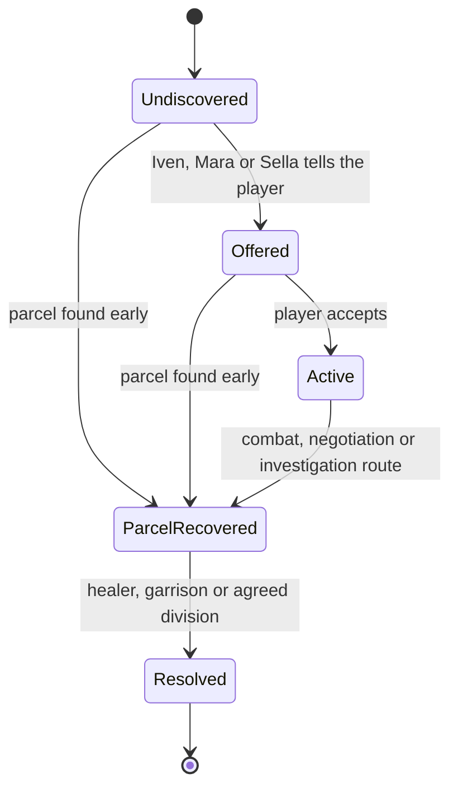

# Living Vale — the first slice's content (G0)

**Status:** proposed freeze, 5 November 2026, **awaiting the lead's sign-off**. It collects
what [the design](living-vale-design.md) already decided into one list, so that parallel work
builds on the same names and nothing invented gets built on. Where the design gives no value,
the cell says who sets it. Changing anything here after sign-off is a scope change: edit this
page in the same pull request.

## Stable IDs

Saves, drivers, targets and tests key on these, never on display or scene names. Formats:
`npc_<name>`, `item_<name>`, `quest_<name>`, `place_<name>`. A display name may change; an ID
does not.

## Places

| ID | Name | First-slice content |
|---|---|---|
| `place_briar_glen` | Briar Glen | Arrival village: market stall, healer's porch, inn exterior. **The G1 grey box is this village.** |
| `place_reedbank` | Reedbank | Second village: workshop, farm plots, river crossing |
| `place_ashwatch` | Ashwatch Castle | Gatehouse and courtyard only; interiors closed |
| `place_old_road` | Old Road | Wagon wreck, woodland bend, short ambush |
| `place_broken_watch` | Broken Watch | Ruined camp holding the medical parcel |
| `place_herb_hollow` | Herb Hollow | Herbs, one optional wolf, a landmark |

### Region layout (grey box)

Shared coordinates, so the world, the quests and the art can be built in parallel and still
meet. These are world positions in metres, with y up and the village square at the origin.
They are a starting layout to tune by travel time (design §2: 45–90 s between neighbours).

| Place | Centre (x, z) | Footprint | Who is there | Joins |
|---|---|---|---|---|
| `place_briar_glen` | (0, 0) | the G1 village block, about 40 × 36 | Mara, Iven, Sella | Old Road, Herb Hollow |
| South meadow (part of the Glen) | (0, −30) | G2's combat meadow | the raider and the wolf | start of the Old Road |
| `place_old_road` | (40, −150) | road bend about 60 × 30, the wagon wreck at the centre | — | Glen, Reedbank, Broken Watch |
| `place_reedbank` | (170, −110) | about 50 × 40, workshop, farm plots, river crossing | Toma, Fen | Old Road, Ashwatch |
| `place_ashwatch` | (230, 60) | gatehouse and courtyard edge, about 40 × 30 | Brann, Elra | Reedbank |
| `place_broken_watch` | (−80, −270) | ruined wall and camp, about 40 × 40 | Kest, camp defenders | Old Road, Herb Hollow |
| `place_herb_hollow` | (−150, −20) | clearing about 30 × 30, three herb spots, a landmark | one optional wolf | Glen, Broken Watch |

Paths are flat strips between neighbours. The ground is a 600 × 600 plane until terrain
replaces it. The player starts in the Glen. Respawn stays in the Glen (design §4).

## Speaking NPCs (eight)

| ID | Name | Role | Place | Essential |
|---|---|---|---|---|
| `npc_mara` | Mara | General trader | Briar Glen | No |
| `npc_iven` | Iven | Healer; main quest giver | Briar Glen | **Yes** |
| `npc_sella` | Sella | Innkeeper | Briar Glen | No |
| `npc_toma` | Toma | Smith | Reedbank | No |
| `npc_fen` | Fen | Farm worker, witness | Reedbank | **Yes** (holds the investigation clue) |
| `npc_brann` | Brann | Gate guard | Ashwatch | **Yes** (delivery permit) |
| `npc_elra` | Elra | Castle steward | Ashwatch gate | **Yes** |
| `npc_kest` | Kest | Camp leader | Broken Watch | **Yes** (negotiated route) |

Essential characters recover after being incapacitated (design §4). What each knows, and the
actions each may take, are in design §7 and §10.

## Items (twelve)

| ID | Kind | Stack | Price | Sells for | Notes |
|---|---|---|---|---|---|
| `item_starter_sword` | Weapon | 1 | 8 | 4 | Worn at the start |
| `item_iron_sword` | Weapon | 1 | **30** | 15 | Toma (not stocked yet) |
| `item_sturdy_sword` | Weapon | 1 | 55 | 27 | Reward or Toma |
| `item_traveler_armor` | Armor | 1 | 12 | 6 | Worn at the start |
| `item_padded_armor` | Armor | 1 | 35 | 17 | Toma |
| `item_healing_potion` | Consumable | 5 | **10** | 5 | Restores 40 health; Mara stocks 6 |
| `item_bread` | Consumable | 10 | 3 | 1 | Mara stocks 10 |
| `item_herb_bundle` | Material | 10 | 4 | 2 | Herb Hollow; Mara stocks 8 and buys them |
| `item_iron_scrap` | Material | 20 | 5 | 2 | Raider loot, 2 per raider; Mara buys |
| `item_wolf_pelt` | Material | 10 | 8 | 4 | Wolf loot, 1 per wolf; Mara buys |
| `item_lost_badge` | Quest | 1 | — | Never | *A Dented Badge* |
| `item_medical_parcel` | Quest | 1 | — | Never | The main quest's object |

The values are G3's, from `ItemCatalog.CreateDefault` and `VendorStock.CreateMara` in
`Assets/LivingVale/Game/`, merged on 5 November. "Sells for" is what a vendor pays: half the
price, at least 1, so always below the price. Fixed by the design: start with **40 gold**,
finite stock, and quest items that cannot be sold, dropped or destroyed. The starting
inventory is the starter sword and traveler armor worn, one potion and two bread. A defeat
costs a tenth of the gold, at least 1, never items.

## Quests

**Main: *The Missing Wagon*** (`quest_missing_wagon`). States, with discovery allowed to skip
ahead and clues stored apart from the state:

There are three recovery routes (combat, negotiation after a verified favor or payment, and an
investigation clue from Fen) and three authored dispositions. No branch can block completion.

**Side quests:** *Herbs Before Sundown* (`quest_herbs`, three herbs to Iven, no real timer)
and *A Dented Badge* (`quest_badge`, the badge back to Brann).

**XP budget** (design §6): main quest 120, each side quest 50, three landmark discoveries at 10
each, 250 in all. Level 2 at 100 and level 3 at 250.

## Who owns what, while sessions work in parallel

| Area | Owner | Files |
|---|---|---|
| Conversation contract | G3 session until it merges | `Assets/LivingVale/Interaction/` |
| Items, inventory, gold, trade | G3 session | `Assets/LivingVale/Game/` |
| Combat, enemies, respawn | G2 session | `Assets/LivingVale/Combat/` |
| Real NPC decisions | G5 session | `Assets/LivingVale/Agenerela/` |
| Shared wiring | Edited additively by all three, merged by the coordinator | `ValeBootstrap`, `NpcInteraction`, `ChatOverlay`, `VillageSceneBuilder` |
| This page, merges, play-checks | Coordinator | `docs/demos/`, the `69-living-vale` branch |

Scenes are generated by builder scripts, one per location as the region grows. Nobody edits
a `.unity` file by hand, so two branches never conflict inside scene YAML.

## Cut first if time is short

Voice, weather, castle interiors, crafting, extra content, day/night routines, and generated
quests (G6a) are cut before the core chat, trade, quest, combat, inventory and levelling loop
(design §15, roadmap "Pending decisions").

## Open for the lead

- The final title. *Living Vale* is a working name; the region is *Briar Vale*.
- Whether Fen and Kest must be essential: the design protects quest characters, and each of
  them is the only way into one recovery route.
- Sign-off of this page, which closes G0.
