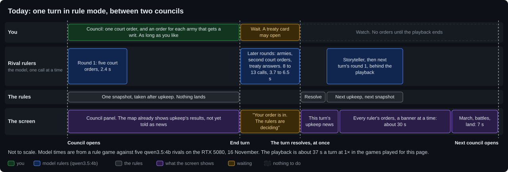
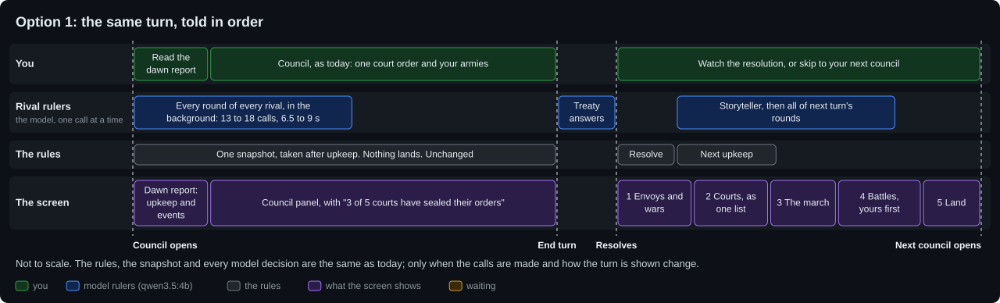
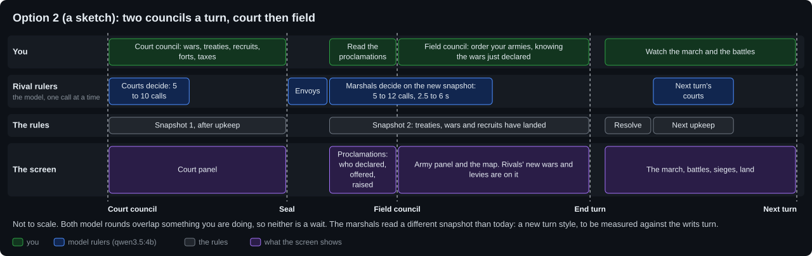
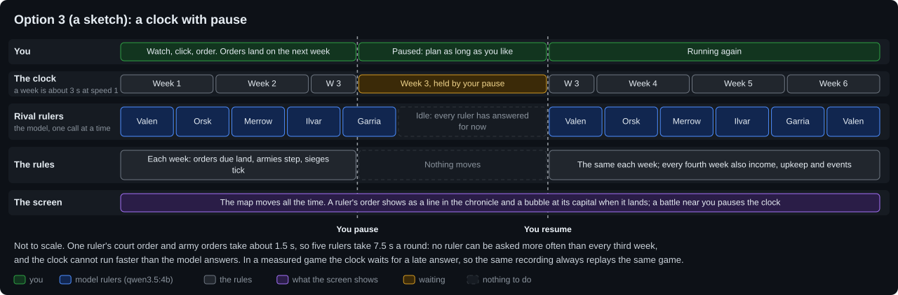

# Painted Realm: how a turn is played, what may feel strange, and three ways to change it

Research for the lead, 16 November 2026. After playing the game he said: "We also need to research the way that the
turns are done, its kind of strange right now and please see what we can do". He did not say what felt strange. This
page describes today's turn exactly, ranks what is likely to feel strange with the evidence for each, looks at how
other games arrange time, and proposes three changes, from smallest to largest. **No game code changed.** Every new
mechanic here is marked _a sketch_: none of it is built or measured.

It is about **Rule mode on the writs turn**, the game New game starts by default: you rule one realm, a model rules
each of the others. The rules themselves are in [`painted-realm-rules-v2.md`](painted-realm-rules-v2.md#1-the-turn);
this page is about the order things happen in and what you see while they do.

## In short

- **Today's turn:** you give your orders; you press End turn; you wait about 5 s while the rivals finish theirs; the
  rules resolve everything at once; the screen then plays the turn back for about 37 s, of which about 29 s is every
  ruler's orders read out one banner at a time and about 7 s is armies moving and fighting. Your next council opens
  when the playback ends.
- **Most likely what felt strange, in order:** the read-out is long and mostly about other realms; the game goes quiet
  after End turn; news of what upkeep did to you is told after you have ordered, not before; you answer moves you
  cannot see; many turns give you one or two things to do.
- **Recommended: option 1**, "the same turn, told in order". The rivals decide everything while you plan, the council
  opens with what happened to you, and the resolution plays as five short named steps with your part first. It changes
  no rule and no model decision, so every finding so far stands.
- **Option 2**, two councils a turn (court, then armies), lets every ruler's armies answer the wars just declared. It
  is a new turn style and needs its own A/B. **Option 3**, a clock with pause, is closest to Europa Universalis, costs
  the most, and is capped by how fast the model answers: about two decisions a second.
- **Five questions for the lead** are [at the end](#questions-for-the-lead), each with a proposed answer.

## Where this comes from

| Source | What it gave |
|---|---|
| The code | `Sim/Rules/WritTurn.cs` and `Game.cs` (the order of a turn), `Screen/RuleSession.cs` (when each ruler is asked), `Screen/ReplayDirector*.cs` (what the screen shows and for how long) |
| A real rule game, 16 November | The decision log of a ten-turn game against five `qwen3.5:4b` rivals on the RTX 5080, on a generated world: every model call with its time. All model times on this page are from it |
| Two games played for this page | Fourteen turns each as Kesh (seed 7) and as Orsk (seed 11) on the Classic board, headless through the real rule session, with stand-in rivals that pick a legal order at random. Each turn's orders, refusals and resolution were written down, and the playback's length worked out from the screen's own waits |
| One game on screen | Four turns as Kesh with stand-in rivals at 1× speed, through the Unity CLI, to time the playback on the real screen |

No model was called for this page. The stand-in rivals say short stock lines and offer peace far more often than the
models do, so their games show the turn's shape, not how the models play.

## 1. Today's turn

Between two presses of End turn, in order:

1. **You press End turn.** Your orders are sealed as one plan: the court's order, an order for each army that got a
   writ, and a second court order if a writ was left.
2. **You wait while the rivals finish.** Each rival has two model agents, a court and a marshal. Their first court
   order was decided earlier (step 7). Now the rest are asked, a round at a time: an army order from each ruler, then
   the next army or a second court order, until each has spent its writs. The model answers one call at a time. In the
   16 November game this was 8 to 13 calls and **3.7 to 6.5 s**, more as the rivals raised armies. The screen says
   "Your order is in. The rulers are deciding" with a clock.
3. **Treaties are answered.** Every treaty term ordered this turn is put to the other side: a model court answers in
   one more call, and a term put to you opens a card with Accept and Refuse. At most two for each ruler a turn.
4. **The rules resolve the turn, at once**, in this order. Every order is checked again as it lands and refused with a
   reason if the world has changed under it.
   - treaties, then declarations of war;
   - recruits, taxes and forts;
   - army orders take effect, then **every marching army steps at the same moment**;
   - battles, wherever enemies now share a province or crossed one border;
   - sieges tick, undefended enemy land is occupied, neutral land entered is taken;
   - stores, broken realms, eliminations, victory.
5. **The screen plays the turn back**, one event after another: first this turn's upkeep news (your harvest, your
   deserters, a truce ending), which happened before your council; then every ruler's orders in the order they landed,
   each court order with its statement as a banner; then the march, each battle, each change of land. You cannot order
   while it plays. Space pauses and `+` doubles the speed, up to 4×.
6. **Meanwhile, behind the playback, the next turn has already begun.** With a storyteller, it chooses the next event
   (one model call, and one for a tale's title). Upkeep runs: truces count down, income, food and upkeep are paid,
   stores refill or run down, the event lands, provinces revolt. The result is the **snapshot** every ruler decides on.
7. **The rivals' first court orders are asked on that snapshot**, straight away: five calls, 2.3 to 2.4 s. They are
   usually in before the playback ends.
8. **Your council opens** when the playback ends. The map jumps to the snapshot. You plan for as long as you like.

Three things about the snapshot matter for the rest of this page:

- **Everyone decides on the same snapshot, and nothing lands until step 4.** A rival does not see your orders, you do
  not see theirs, and a ruler's own orders do not see each other's results.
- **The rivals do not all decide while you plan.** Only their first court order does. The other rounds wait for End
  turn, because the rules take one round of answers from all rulers together, and yours exist only once you seal them.
- **What a rival decided opens in the inspector only after it has landed**, by clicking its chronicle line or banner.

### How long each part takes

| Part | Time | Who is waiting |
|---|---|---|
| Your council | 20 to 60 s in the 16 November game; no limit | nobody |
| Rivals' first court orders (5 calls) | 2.3 to 2.4 s; 5.9 s on turn 1 while the model loads | nobody: hidden behind the last playback |
| Rivals' other orders after End turn (8 to 13 calls) | **3.7 to 6.5 s** | you |
| Your treaty cards | up to two a turn; the game waits for you | the game |
| The rules resolving | no time | |
| The playback at 1× | **about 37 s a turn** (23 to 53 s) in the two games played for this page; see below | you |
| Storyteller and next upkeep | one or two calls | nobody: hidden behind the playback |

The playback's length is worked out from the screen's own waits (a banner stays 1.5 s plus 0.04 s a character, an army
order line 60% of that, a march step 0.6 s, a battle about 1.5 s), over 28 turns:

| Part of the playback | Seconds a turn at 1× | Share |
|---|---|---|
| Court orders and envoys, a banner each | 22 | 59% |
| Army order lines | 7 | 19% |
| The march, battles, land changing | 7 | 20% |
| Upkeep news | 1 | 2% |
| **Of all that, events of your own realm** | **5** | **13%** |

On the real screen at 1×, the first three turns as Kesh took about 38, 27 and 31 s from End turn to the next council
(timed through the Unity CLI, to within about 2 s), against 38, 23 and 30 s worked out from the waits. With stand-in
rivals there is no wait for the model, so this is the playback alone.

The stand-in rivals' lines are about 35 characters. The models' are longer: 74 characters at the median in the
16 November game, which adds about 1.5 s to every banner.

### What writs limit

A realm has **3 writs a turn, one more for every 8 provinces, at most 5** (`GameRules.BaseWrits`; the rules page's
first draft said 2). One writ is always the court's. So at the start you give **one court order and orders to two
armies**. A second court order is asked only when a writ is left after the armies and the first was not "none".

- **An army costs a writ only when it is asked.** An army carrying out an order (marching on, besieging, holding)
  costs nothing and is not asked.
- **An army is asked when something wakes it**: it arrived, fought, was raised, a war began or ended, an enemy came
  near, its stores ran low, or four turns passed. You can also recall one that has not woken, for a writ.
- **An army awaiting orders that gets no writ holds**, and waits for the next turn.
- New game can give you alone unlimited writs. The rivals keep the cap, which also bounds the model's time.

### Marches, sieges and the storyteller

- **A march** names a destination up to four provinces away. The army takes one step a turn into plains or forest and
  one step every two turns into rougher land, and may take further steps in the same turn over open ground where it
  meets nothing. Until it arrives or something wakes it, it asks for nothing: a three-province march is one order and
  two or three turns in which that army gives you nothing to do.
- **A siege** begins when an army stands alone in walled enemy land. It counts one turn at each resolution and never
  ends on the turn it begins. The army is asked again when the siege ends.
- **The storyteller** decides between turns (step 6). Its event lands at upkeep, before your council, and is told by
  the chronicler's banner in the playback of that turn, after you have ordered. A dilemma is different: its card stops
  the game before upkeep and waits for your choice while the rival courts choose theirs.

### The other two ways to play

- **Watch mode** has no council of yours: all the rivals' rounds run back to back (7.1 s of model time a turn for five
  rulers, [findings](../llm-wiki/findings.md), 13 November), and the playback hides them.
- **The older turn**, "one move", gives every ruler one move a turn with no armies on the map. The menu's Replay is a
  game of that kind, so the Replay and a new Rule game do not play the same way.

## 2. What is likely to feel strange

Ranked by how likely each is to be what the lead meant, judged from the evidence. Candidates 1 to 3 are about how the
turn is **told**; 4 to 6 are about how it is **built**.

| # | What feels strange | Evidence | Fixed by |
|---|---|---|---|
| 1 | **The read-out.** After End turn the screen spends most of its time on other realms' orders, one at a time, and the part you care about (did my army win?) comes last and is over in seconds | About 37 s a turn, 78% of it orders being read out, 13% about your own realm. With stand-in rivals a ruler's "We wait and watch" still gets its own 2.2 s banner. In the 16 November game the model courts' second order repeated their first 26 times in 28, so the same recruit or tax is read out twice | Option 1 |
| 2 | **The quiet after End turn.** Nothing moves for some seconds, and the wait grows through the game | 3.7 s on turn 2, 6.4 s on turn 9 in the 16 November game. The council says "The four rulers have decided. Your orders?" when 5 of their 13 to 18 calls are in | Option 1 |
| 3 | **News out of order.** What upkeep did to you is applied silently when your council opens and told after you have ordered | In the code, a turn's playback starts from the state before its upkeep and tells the upkeep first. In the game as Kesh, turn 7's council opened with a truce ended and a point of stability lost, and both were told after End turn. A storyteller event is told the same way. Only the Report button says it earlier | Option 1 |
| 4 | **Answering blind.** You order without seeing what the rivals ordered this turn, and learn it in the read-out | As Kesh, turn 3: I declared war on Ilvar and Valen declared war on me in the same turn. Turn 9: I sent 10 soldiers to Brindle, which my larger army was leaving; Valen's 44 arrived the same turn and destroyed them. Six orders were refused as stale in that game and thirteen in the other | Option 2, or the open-courts switch |
| 5 | **Little to do.** Many turns are one court order and one or two army orders, and a marching army gives you nothing to do for two or three turns | As Kesh, 2 turns of 14 were a court order alone and none had more than two army orders. In the 16 November game the five model courts chose recruit or taxes in 73 of their 78 court orders over ten turns and declared one war. On the Classic board no province changes hands in 69% of turns ([findings](../llm-wiki/findings.md), 13 November) | Not by this page: it is rules and balance |
| 6 | **Your own orders trip over the landing order.** Treaties land before marches, so peace offered and a march into that realm in one turn cancel each other; war declared and a march in one turn work | As Kesh, turn 4: I offered Ilvar white peace and sent an army at Southgate. Ilvar accepted, and my march was refused: "southgate belongs to ilvar, at peace with us". The screen says only that moves "land in the rules' order" | Option 1 names the steps; option 2 separates them |
| 7 | **The same envoy twice.** A rival's two court orders can be the same treaty term, and you get the same card twice | As Kesh, turns 5, 7 and 9: two identical white-peace cards from one realm in one turn | A small fix on its own |
| 8 | **Writs are hard to read as a budget.** Which armies get a writ is the rules' order, the court's second order depends on what the armies left, and a holding army costs a writ to move | The 15 November readiness pass already listed the writs counter first among what a new player trips on. In these two games an army was never left without a writ, so the cap itself did not bite early | The clarity pass covered most of it |

### Moments I did not know what was happening or why

Written down while reading each turn as a player would, in the two games played for this page.

| Turn | Moment |
|---|---|
| Kesh 2 | My treasury fell from 55 to 20 to 0 in two turns of recruiting. Nothing at the council said the next recruit would empty it |
| Kesh 2, 3 | My one army was marching. The whole turn was one court order |
| Kesh 3 | Valen declared war on me in the turn I declared war on Ilvar. I learned it from one banner among fifteen other events |
| Kesh 4 | My own march was refused because my own peace offer landed first |
| Kesh 5 | Two envoy cards from Valen with the same words, one after the other |
| Kesh 7 | Stability dropped and a truce ended before my council. I saw the numbers change and the reason only after End turn |
| Kesh 8 | I offered Merrow peace. After End turn Merrow's envoy offered me the same peace on a card. Refusing the card and having mine refused were both possible in one turn |
| Kesh 9 | An army of mine was destroyed in a province I occupied when I gave the order |
| Orsk 4 | 26 events in one playback, about 53 s at 1×, four of them mine |

## 3. How other games arrange time

For each: what it would mean here, where a model ruler takes about half a second a call, one call at a time (Ollama
refuses parallel requests for `qwen3.5`, [findings](../llm-wiki/findings.md), 11 November), and a full round of five
rulers takes about 7 s.

| Arrangement | Known from | Here it would feel like | Model time and waiting | The showcase | What it changes |
|---|---|---|---|---|---|
| **Simultaneous turns, hidden orders** | Diplomacy, Dominions | **What we have.** Everyone writes orders; all land at once; the reveal is the drama | One round a turn, about 7 s, which can hide behind your planning | Decisions are read after they land | Nothing |
| **We-go with a watched resolution** | Combat Mission, Frozen Synapse | The same orders phase, then a short resolution staged as a scene you watch on purpose, with a clear start and end | The same | The same, and the resolution can stop on a decision worth reading | The screen only |
| **I go, you go** | Civilization | Each ruler takes its whole turn in seat order, and you watch each rival act before you do | The same calls, but none can run early: each ruler decides on the world the one before left. About 7 s of rivals between your turns, shown as their moves | Good for reading: one ruler acts at a time. But the framework's round of several agents on one snapshot is no longer used | The Sim's whole resolution (seat order returns, with its first-mover edge), every finding, the recording's order |
| **Phases within a turn** | Diplomacy's orders, retreats and builds; many board war games | A turn in two or three short stops: diplomacy and levies, then marches and battles | The same calls, split so that each model round overlaps something you are doing | You read the courts' decisions before the armies move | A new turn style in the Sim, the agents' facts, the recorder, the council |
| **Action points** | Old World's orders | **Writs are this already**: a small budget of orders a turn | Bounded by the budget | Unchanged | Nothing; the budget's size is balance |
| **Real time with pause** | Europa Universalis IV, Victoria 3, Crusader Kings III | A clock; armies move continuously; you pause to think; rivals act when their turn to be asked comes round | About two calls a second. With five rulers no ruler can be asked more often than every 7 s, so the clock's speed is capped by the model, not by the player | Decisions arrive while the map moves; you pause to read one | Time itself in the Sim, the agents' schedule, the screen's controls, the recorder, every finding |

Two things follow. **The turn's structure is not unusual**: simultaneous hidden orders is a respected design, and its
weak point here is how the reveal is staged. And **the structures that let rulers react to each other** (I go, you
go; phases; the clock) all give up the single snapshot the findings were measured on.

## 4. Three options

### Option 1: the same turn, told in order

The rules, the snapshot and every model decision stay exactly as they are. Three things change: when the model calls
are made, when the news is told, and how the resolution is staged. _A sketch._

**What you do and see:**

| When | You | The screen |
|---|---|---|
| 0:00 | Read what happened to your realm | **A dawn report** opens the council: income, your events, the storyteller's event, truces ended, anything refused last turn. Five seconds, or a click |
| 0:05 | Plan as today | The council panel. A line counts the rivals in: "3 of 5 courts have sealed their orders". It is a fact about the model, shown as the model works |
| about 0:40 | Press End turn | Within a second (treaty answers only), the resolution begins. If you were faster than the model, the count finishes first |
| 0:41 | Watch, or press a key to skip to your next council | **Five named steps**, the step's name in the top bar: **1 Envoys and wars**: treaties and declarations, a banner only for those that touch you. **2 Courts**: every court's order appears at once as a line at its capital and in the chronicle; a statement is a bubble by its realm, not a banner in a queue. **3 The march**: every army steps together, as today. **4 Battles**: yours first, and the clock stops on yours until you click. **5 Land**: occupation, sieges, land taken |
| about 0:55 | Next council | A one-line summary stays above the dawn report: "Turn 9: you lost Ingram's host at Brindle; Valen freed Brindle; Orsk took Glimmerford" |

**Model decisions:** the same calls on the same snapshot. They are made earlier: all of a rival's rounds run as soon
as the snapshot exists, behind the playback and your planning, instead of the later rounds waiting for End turn. This
is possible because a rival's later requests depend only on the snapshot and on its own earlier answers. Rivals still
do not see your orders.

**What must be built** (small: one Sim-and-session pull request and one screen pull request, about the size of the
15 November clarity pass):

- `Game.Submit` takes one ruler's answer without the others' (today it takes a round from all), and `RuleSession`
  runs the rivals' rounds without waiting for your plan. A test: a recording replays to the same game.
- The playback's upkeep events move to the opening of the next council.
- The resolution's five steps: grouping the events the replay already has, the bubbles, yours first, the stop on your
  battle, skip.
- Identical orders from one court fold into one line ("recruits pikes, twice"), and identical treaty offers into one
  card.

**Findings it invalidates:** none. Model games, their recordings and their scores are unchanged, and watch mode shows
the same game with a shorter telling.

**Risks:**

- The three UI branches open today (`20-realm-ui-controls`, `20-realm-ui-cutoffs`, `20-realm-ui-storyteller`) touch
  the same screen files. This should start when they have merged.
- Statements shown together are easier to miss than a banner each. The chronicle keeps every one, and a line said to
  you or about you keeps its banner.
- It does nothing for candidates 4 and 5. If the lead meant answering blind or too little to do, this is not enough.

**The open-courts switch** (_a sketch_, optional, on top of option 1): when your council opens, each rival court's
first order is already decided. Show it then, as a sealed proclamation you can read and open in the inspector
**before** you give your own orders. Armies' orders stay hidden. It changes no model decision and no model game; it
gives the person a turn's warning of a war or a levy, and it puts the framework's showcase, reading why a model
decided, at the moment the reading matters. Question 3 asks about it.

### Option 2: two councils a turn, court then field

A turn in two halves. _A sketch: the mechanic is invented here and unmeasured._

**What you do and see:**

| When | You | The screen |
|---|---|---|
| 0:00 | **Court council**: your court order (war, a treaty term, recruit, fort, taxes) | The dawn report, then the court panel |
| about 0:15 | Seal it | Treaties are answered; then **the proclamations**: every court's order lands and is shown, as option 1's steps 1 and 2. About 8 s |
| about 0:25 | **Field council**: order your armies | The map now shows the wars just declared and the armies just raised, yours and theirs. The army panel, as today |
| about 0:50 | Press End turn | **The march and the battles**, as option 1's steps 3 to 5 |
| about 1:00 | Next turn | |

**Model decisions:** the same number of calls, in two rounds on two snapshots. Courts decide on the snapshot after
upkeep, behind the last playback, as today. **Marshals decide on a new snapshot, after every court order has landed**,
so a marshal sees the war declared on its realm this turn, and sees your court order as well. Both rounds overlap
something you are doing (the last playback, and your field council), so neither is a wait unless you are faster than
about 6 s. Each round can still be one `DecisionRound` on one snapshot.

**What must be built** (medium: a slice like R1 was, with rules, agents, screen and a measured run):

- A third turn style in the Sim beside "writs" and "one move": the resolution split in two, court orders first, and
  the army requests built after it. Writs become one or two court orders and the rest for armies.
- The marshals' facts say what the courts just did. The recorder marks the half a decision belongs to; old recordings
  replay under their own style.
- The council in two stops, and option 1's staging for each half.
- **An A/B before it becomes the default**: this style against the writs turn, the same seeds, 15 to 20 games an arm
  on the persona table. The number to watch is "answers an attack", 21% on the writs turn
  ([findings](../llm-wiki/findings.md), 13 November): letting armies answer in the same turn is what this option is for.

**Findings it invalidates:** every result measured on the writs turn describes the one-snapshot turn and stays true
only for it: the live run of 13 November (7.1 s a turn, orders a ruler, refusals, treaties), the statement repeats,
and the first looks at unit types, generals, sieges, supply, hunger first, the counters line and land traditions of
14 to 16 November. None carries to the new style without a control arm. The storyteller's results on the one-move
game are not touched.

**Risks:**

- Two stops a turn is more clicking, in a game whose turns already change little.
- Armies that answer in the same turn favour the defender. Classic games already stall; this may slow them further.
- A third turn style to keep working. If it is adopted, the one-move game should leave the menu.

### Option 3: a clock with pause

The Europa Universalis arrangement, sized to the model. _A sketch: invented here, unmeasured, and the largest change
this game could make._

- **Time runs in weeks**, about 3 s each at speed 1. Every week, orders that are due land, armies step, sieges tick.
  Every fourth week is upkeep: income, food, events.
- **You order at any time**, paused or running, with no End turn. Your order lands on the next week.
- **The rulers take turns at the model.** One ruler's court order and army orders take about 1.5 s; five rulers take
  about 7.5 s. So each ruler is asked about every third week, on that week's snapshot, and its orders land a fixed
  number of weeks later. Marshals are asked when an army wakes, as today.
- **The clock cannot outrun the model.** At speed 1 a ruler acts every 9 s or so. A faster speed either leaves the
  rulers acting less often, which makes them look slow, or stalls. There is no speed 5. Six or eight rulers stretch
  it further: a round is 8.7 s for six.

**What you do and see:** the map moves all the time. An order of a rival's is a line in the chronicle and a bubble at
its capital when it lands. A battle near you pauses the clock. To read a decision you pause and open it.

**Model decisions:** every ruler decides on a different snapshot, a round of one. Rulers react to each other and to
you within a few weeks. A decision is checked again when it lands, as today, and more of them will be stale.

**Honest about latency:** a live game's outcome would depend on how long each answer took, unless the lag is fixed in
weeks and **the clock waits for a late answer**. With that rule a game replays exactly from its recording and two runs
of a seed can be compared; without it neither holds. So the clock must stutter when the server is slow.

**What must be built** (very large: time is rebuilt in the rules, the agents, the screen and the recorder):

- The Sim's turn becomes a week: marches in days or weeks, upkeep monthly, sieges, supply, truces and the stalemate
  rule all restated in the new unit.
- A schedule for who is asked when, using the framework's queue and priorities; the recorder writes the week each
  decision was asked and the week it landed.
- The screen: a clock and speed controls, continuous movement, alerts, orders without a council. The council panel
  built this week is mostly not used.
- A new baseline: every per-turn number in the scorecard needs a new unit, and a full measured run.

**Findings it invalidates:** all of the strategy demo's, on both turn styles.

**Risks:** it will be compared with the games it imitates, and at two decisions a second it will feel slower than
they do. It takes the weeks planned for map art, flags, portraits and the storyteller's decisions.

### Recommendation

**Build option 1 next, then play it.**

- It answers the three top candidates, which are all about how the turn is told, and they have the strongest
  evidence: 37 s of playback of which 5 s is yours, a wait that grows to 6.5 s, and news told after it mattered.
- It costs no finding. Everything measured since 13 November was measured on this turn, and the demo's purpose is to
  show measured model rulers.
- It is small, and it is the first half of option 2 anyway: option 2 uses the same dawn report and the same staged
  steps.

**Keep option 2 as the next experiment**, to design only if the game still feels like answering blind once option 1
is played. It is the smallest change that lets rulers react within a turn, and it keeps one snapshot per round, which
is what the framework's `DecisionRound` is for.

**Do not build option 3 now.** It is the closest to the games the lead named, and that direction was given for the
interface and controls, which variant B already follows. A clock would replace the measured game with an unmeasured
one, and the model, not the player, would set its speed. It is worth recording as an idea.

## Questions for the lead

Each can be answered in a line.

1. **Which of these is what felt strange?** (a) the wait and the long read-out after End turn; (b) news told after
   you ordered; (c) not seeing the rivals' moves before answering them; (d) too little to do in a turn; (e) something
   else. _Proposed answer:_ a and b, which option 1 fixes. If it was c, option 2 moves up; if d, it is a rules and
   balance question and none of the three options answers it.
2. **Build option 1 next, once the three UI branches have merged?** _Proposed answer:_ yes.
3. **Show each rival court's first order when your council opens, to read and inspect before you order** (the
   open-courts switch)? _Proposed answer:_ yes, as a New game setting, on by default in Rule mode. Armies' orders stay
   hidden. It changes no model game.
4. **In the resolution, may the rivals' statements become bubbles shown together and lines in the chronicle, instead
   of one banner at a time?** _Proposed answer:_ yes. A war declared on you, a treaty with you and the storyteller
   keep their own banner.
5. **Option 2 and option 3: design either now?** _Proposed answer:_ neither. Option 2 waits until option 1 has been
   played; option 3 goes to the Ideas column as an idea, not a plan.

## Noticed on the way

Not part of the question, and nothing here was changed.

- The rules page says 2 writs a turn and treaties enforced at a war score of 90; the code has 3 and 80
  (`GameRules.BaseWrits`, `EnforcedScore`).
- A model court's second order repeated its first 26 times in 28 in the 16 November game. Whether the second court
  order earns its call (about 0.5 s a ruler a turn) is a question for a measured run.
- The menu's Replay is a one-move game, and New game's default is the writs turn.
