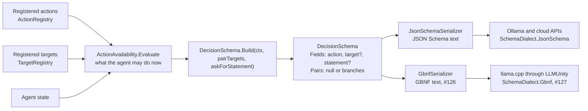
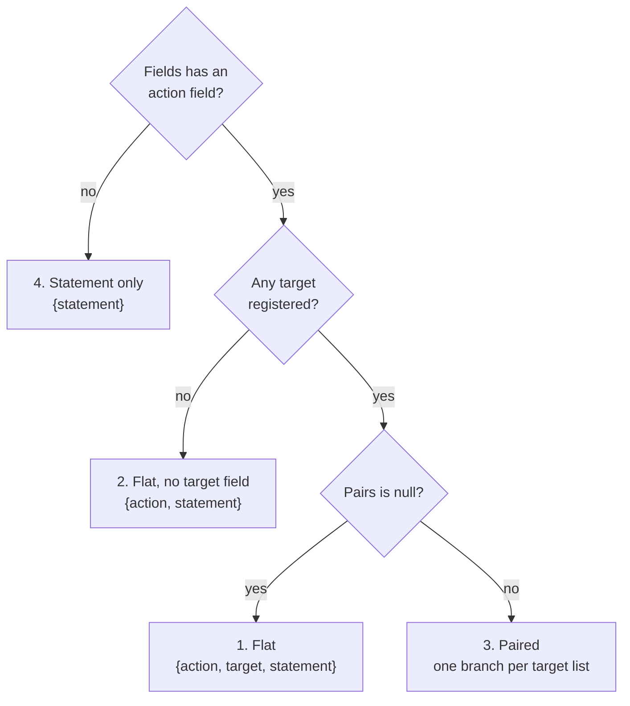

# The decision schema today: what a serializer has to write (12 November 2026)

Written for #126 (`GbnfSerializer`), because the schema grew after that issue was filed. It
describes what `DecisionSchema` can hold on `test` at 8099dfa and what `JsonSchemaSerializer`
writes for each case, so a second serializer can match it. Everything here is read from the code
and its tests; the file and test names are given so each claim can be checked. If the code and
this page disagree, the code is right: fix the page.

**The one thing that changed most:** a schema can now be **paired** (DR-020, #210). The issue
lists "per-action target lists" as a later extension. It has since been built, it is what the
strategy demo uses by default, and `JsonSchemaSerializer` writes it. A grammar with "exactly the
constraints `JsonSchemaSerializer` emits" has to handle it.

## Where the schema comes from



`DecisionSchema` is provider-neutral: ids and order, no syntax. A provider reads
`ProviderCapabilities.Dialect` and runs the serializer for its dialect. Nothing about GBNF may leak
into `DecisionSchema`.

## What a `DecisionSchema` holds

`Runtime/Schema/DecisionSchema.cs`, `SchemaField.cs`, `ActionTargets.cs`.

| Member | What it is |
|---|---|
| `Fields` | The answer's fields **in generation order**. Never reorder them: the order is a measured rule (action, then target, then the free text). Note the spelling: `Fields`. |
| `Pairs` | `null` for a flat schema. Otherwise one `ActionTargets` branch per distinct target list. |

A `SchemaField` has:

| Member | Meaning for a serializer |
|---|---|
| `Name` | The JSON key: `action`, `target` or `statement` (`DecisionSchema.ActionFieldName` and its siblings). |
| `Description` | Text for a model that is shown the schema. JSON Schema carries it; a grammar has nowhere to put it, so GBNF drops it. |
| `AllowedValues` | The only values allowed, in order, or `null` for a free-form string. |
| `Required` | Whether every answer must contain the field. Every field is `true` in every schema `DecisionSchema.Build` makes. A hand-built schema may set it `false`, and `JsonSchemaSerializer` then leaves the field out of `required` (test `OnlyRequiredFieldsAreListedAsRequired`). |

An `ActionTargets` branch has `Actions` (ids in the action enum's order) and `Targets` (ids in the
target enum's order, `no_target` first when the actions may take none). Every action in a branch
takes exactly that branch's targets.

Two reserved values: `none` (`ActionRegistry.None`, "take no action", always the **last** action)
and `no_target` (`TargetRegistry.NoTarget`, always the **first** target in the flat enum). There
is never an empty string in an enum: Gemini rejects `""` with HTTP 400, which is why "no target"
is a word.

## The four shapes



### 1. Flat: `action`, `target`, `statement`

The default. Any action may be written with any target; the guards sort out a wrong pair
afterwards. This is the golden in `JsonSchemaSerializerTests.FollowingAgentJson`:

```json
{
  "type": "object",
  "properties": {
    "action": {
      "type": "string",
      "description": "The one action to take now, from the allowed list.",
      "enum": ["stop_following", "move_to", "none"]
    },
    "target": {
      "type": "string",
      "description": "What the action applies to. Use no_target when none of the listed targets applies.",
      "enum": ["no_target", "bridge", "tower"]
    },
    "statement": {
      "type": "string",
      "description": "What the agent says or announces. One or two short sentences, or empty."
    }
  },
  "required": ["action", "target", "statement"],
  "propertyOrdering": ["action", "target", "statement"],
  "additionalProperties": false
}
```

An answer it accepts: `{"action":"move_to","target":"bridge","statement":"On my way."}`. The
statement may be the empty string.

### 2. Flat with no target field: `action`, `statement`

When no target is registered at all, the target field is **left out entirely**, not written with
`no_target` alone (`DecisionSchema.Build`: `if (ctx.Targets.Count > 0)`; test
`EmptyTargetRegistryShapeHasNoTargetProperty`). The object has two keys.

### 3. Paired: one branch per target list

Built when the call sets `DecideOptions.PairTargetsWithActions` and at least one target is
registered. `Fields` is the same three fields with the full enums; `Pairs` says which actions go
with which targets. `JsonSchemaSerializer` writes a root `anyOf` with one object per branch, each
the flat object with its `action` and `target` enums narrowed to that branch. This is the golden in
`PairedSchemaTests.QuestGiverJson`, shortened here to the enums:

```json
{
  "anyOf": [
    { "action": ["move_to"],        "target": ["village_gate", "quest_wolf"] },
    { "action": ["complete_quest"], "target": ["quest_wolf"] },
    { "action": ["none"],           "target": ["no_target"] }
  ]
}
```

Each branch in the real output is a whole object with `type`, `properties`, `required`,
`propertyOrdering` and `additionalProperties: false`, exactly as in shape 1.

How the branches are made (`DecisionSchema.PairsFor`), which decides what a grammar must accept:

- **One branch per distinct target list.** Two actions share a branch exactly when they take the
  same targets in the same order. A branch may hold several actions.
- **Branch order** is the order each list's first action is offered. `none`'s branch is last,
  unless another action takes `no_target` alone, in which case `none` joins that branch.
- **An action that does not require a target** gets `no_target` first, then its targets.
- **An action that requires a target** gets no `no_target`. If it then has no target at all, it is
  not offered (`DecisionSchema.Takeable`): an empty enum would allow no answer.
- **An action marked `TakesNoTarget`** (#245) gets `no_target` alone.
- **Target categories** (`ActionDefinition.AcceptsCategory`) and **the per-target check**
  (`ITargetAvailability`, #235) both narrow a branch's targets. A pair the check rejects is absent
  from the grammar.
- **`none`** always pairs with `no_target` only.

So in a paired schema an action appears in **exactly one** branch, every branch's lists are
non-empty, and every value comes from the flat enums. `JsonSchemaSerializer.ValidatePairs` refuses
a schema that breaks any of these.

### Any of the three without `statement` (#266)

A call that sets `DecideOptions.AskForStatement = false` gets shape 1, 2 or 3 with the `statement`
field left out of `Fields`, and so out of every branch of a paired schema: `{action, target}`, or
`{action}` alone when no target is registered. The enums and the pairs are exactly what they are
with it. `DecisionSchema.AsksForStatement` says which a schema is; the parser reads it, and keeps no
statement a provider sends anyway, and so does `PromptBuilder`, which then sends no statement rules
line and a target rule that does not ask the agent to say anything. A serializer has nothing to do
but walk `Fields` (tests in `NoStatementTests`). The default is on, and every request sent with it
is byte-identical to one sent before the option existed.

### 4. Statement only

`DecisionSchema.StatementOnly()`: one free-form `statement` field and nothing else. It is the
shape of a refusal line's reply (#109), when a guard stopped a move and the agent says why. It is
not a decision, and it goes through the same serializer.

## What `JsonSchemaSerializer` promises, and a grammar should too

| Rule | Where it is tested |
|---|---|
| Fields appear in `Fields` order and are never reordered | `FieldOrderIsPreserved`, `FieldsAreNeverReordered` |
| Enum values keep their order | `EnumValuesKeepTheirOrder` |
| A free-form field has no enum and is a string | `FreeFormFieldHasNoEnum` |
| No key other than the fields is allowed | `AdditionalPropertiesAreForbidden` |
| Text that would break the output is escaped (tested on a description) | `EscapesTextThatWouldBreakTheJson` |
| No target field when there are no targets | `EmptyTargetRegistryShapeHasNoTargetProperty` |
| A paired schema is a choice between whole branches | `PairedSchemaTests` |

**What it refuses** (`ArgumentNullException` for a null schema, `ArgumentException` for the rest):

| Refused | Message contains |
|---|---|
| A null schema | (ArgumentNullException) |
| A null field, or a field with no name | "is null", "has no name" |
| Two fields with the same name | "two fields named" |
| An empty list of allowed values | "empty list of allowed values" |
| A null or `""` allowed value | "null or empty value" |
| The same allowed value twice | "twice" |
| Pairs without an action field and a target field that both have allowed values | "needs an action field and a target field" |
| An empty list of pairs | "empty list of pairs" |
| A pair whose actions or targets are empty | "are empty" |
| A pair with a null or `""` value, or a value twice | "null or empty", "twice" |
| A pair value the flat field does not offer | "does not offer" |
| An action in two pairs | "in two pairs" |
| An offered action in no pair | "in no pair" |

The cases for pairs are spelled out in `PairedSchemaTests.PairsThatNoGrammarCouldHonourAreRefused`.

## What that means for a GBNF grammar

These are suggestions, not a specification; the grammar's exact text is #126's to decide.

- **Flat:** one object rule with the fields in order, each a quoted key, a colon and a value; an
  enum value is an alternation of quoted literals in the enum's order; `statement` is a JSON string.
- **Paired:** an alternation of branch rules at the level of the whole object, one per
  `ActionTargets`, each with its own action alternation and its own target alternation. Because an
  action is in exactly one branch, once the model has written the action only one branch can still
  match, so the target is constrained to that action's targets. That is the whole point of pairing.
- **No target field**, **no statement field** and **statement only** fall out of walking `Fields`
  rather than assuming three fields.
- **`Required = false`:** JSON Schema lets such a field be absent. No schema the framework builds
  has one today. Either make the field optional in the grammar or refuse it clearly; say which in
  the pull request.
- **Ids inside literals:** an id is validated when it is registered (`ActionDefinition.ValidateId`,
  `Targetable.ValidateId`), but the serializer must not rely on that. A value has to be written as
  the JSON string a model would produce (quotes and backslashes escaped), and then that text
  escaped again for a GBNF literal. Non-ASCII ids are legal.
- **Descriptions** are not part of a grammar. A model behind llama.cpp never sees them, as a model
  behind Ollama never does (findings, 10 October 2026); what a local model must know goes in the
  prompt.
- **`propertyOrdering`** is a hint for providers that reorder keys. A grammar fixes the order by
  construction, so it has no equivalent.
- **Whitespace and the string rule** come from llama.cpp's own `json.gbnf`, as the issue says;
  take them from the llama.cpp version LLMUnity ships, and bound the whitespace so a model cannot
  loop on spaces.

Two notes on the first draft on branch `126-GbnfSerializer` (f5deb0e), so they are not a
surprise: the property is `schema.Fields` (the draft reads `Fileds`), and the draft does not look
at `schema.Pairs` yet.

## Fixtures worth a golden file

The issue asks for a golden per `JsonSchemaSerializer` fixture. With the shapes above, that is at
least:

| Fixture | Shape | Source |
|---|---|---|
| The following agent | flat, three fields | `JsonSchemaSerializerTests.FollowingAgentJson` |
| The schema `DecisionSchema.Build` makes for the same agent | flat | `TheSchemaDecisionSchemaBuildsMatchesTheGoldenFile` |
| An agent with no targets | flat, no target field | `EmptyTargetRegistryShapeHasNoTargetProperty` |
| The quest giver | paired, three branches | `PairedSchemaTests.QuestGiverJson` |
| A refusal line | statement only | `DecisionSchema.StatementOnly()` |
| A move with no statement | flat and paired, no statement field | `NoStatementTests` (#266) |
| Ids with a quote, a backslash and a non-ASCII letter | flat | New for #126. `EscapesTextThatWouldBreakTheJson` covers a description, which a grammar does not carry; in GBNF the escaping risk is in the enum values |

## What is not in the schema

So nobody looks for them:

- **No typed parameters.** A decision is one action, one target and one statement, or no statement
  at all (#266). Quantities,
  prices or a strength are not fields (#190 LV #12, #266 item 2).
- **No reasoning field.** A field before `action` measured worst of five variants.
- **No length cap on `statement`.** A runaway reply has been seen once per 460 calls (#244
  item 11); a cap is not built.
- **Nothing about the prompt.** Which actions and targets are listed in the prompt, and how
  (`DecideOptions.ListActionsAndTargets`, `LegalTargets`), is `PromptBuilder`'s business and does
  not change the schema.
