  

> [!WARNING]
> **This is a preview.** It's the second early look at what we're building for 0.4.0, published
> so you can try it and tell us what breaks. It has automated tests and three demo games now run
> on it, but nobody outside the team has built a game with it yet. Expect rough edges, and expect
> the API to change before 0.4.0.

## In short

Agenerela lets a language model decide what your game's characters do, picking only from
actions you've allowed. The first preview was about stopping the model's mistakes. This one
comes from **building real games on the framework** and adding what they turned out to need:
agents you set up in the Inspector, a way to measure how often the model is right, and many
more ways to shape one decision.

## What's new

### 🧩 An agent is a component

Drop **Agent Behaviour** on a GameObject, give it a personality and its actions, and it is an
agent. No manager object, no setup code. Mark a method with `[AgentAction]` and the model can
choose it.

### 📏 Measure it instead of guessing

Two new windows, under **Window → Agenerela**:

- **Prompt Set** is where you write the things a player might say, with the answer you expect.
  A teammate can label the same prompts blind, and the window shows where you two disagree.
- **Evaluation Report** runs two setups against that set, side by side, and tells you which one
  got more right. Change the model, a prompt option or an example, and see whether it helped
  before your players do.

### 🎯 Actions that know which targets they take

Give targets a category, such as `enemy`, `place` or `item`, and say which categories an action
accepts. "Attack the bakery" is now ruled out before the model answers, not caught afterwards.
An action can also say why it is unavailable for one target and fine for another: *the gate is
already open*.

### 🗣️ A decision can be more than "do this to that"

- **Pick one of these.** Hand a call its own list of choices, such as three event outcomes or
  four dialogue replies, and the model picks one. Nothing to register first.
- **Propose, then confirm.** An agent suggests a move, the player sees a card, and the move
  runs only when they accept.
- **One snapshot, many agents.** Several agents decide on the same moment of the game, and you
  run their moves in the order you choose. Made for turn-based games.
- **Pass it on.** One agent's decision becomes another agent's request, in one chain you can
  follow.
- **No words needed.** Ask for the move alone when nobody will read the line, and the reply
  comes back faster.

### 🧠 Agents know more, and remember what happened

- Give an identity standing knowledge and rules for how it speaks.
- A fact ledger keeps the things an agent has been told, and feeds them into each decision.
- Memory now records what came of a decision, not only what was decided, and it can be saved
  and loaded with your game.
- Handlers can report back: *done*, or *failed, and here is why*.

### 🔌 Friendlier with the model

- **A scripted provider** answers from a list you write, with no model at all. Use it for tests
  and for building your game on a machine with no GPU.
- **Provider health.** Agenerela notices when the model is down, stops queueing calls nobody
  will answer, and can hold the newest request for when it returns.
- **Load and unload a model** from code, and switch an agent to another model while the game
  runs.
- **A decision log** writes every decision to a file, with what the model was sent and what it
  said, so you can see why a character did that.
- **Your own guards.** Add a check of your own to the row every answer passes through, and
  give the line a character says when one stops it.

## Not there yet

- **It still only talks to Ollama**, a free app that runs models on your own computer. A game
  you ship would need Ollama on the player's machine too.
- **Our accuracy numbers are from our own test sets**, most of them written and labelled by AI
  models while a hand-checked set is being made. Measure with your own prompts before you
  trust a setup.
- **There is no setup wizard yet**, and no window for watching decisions live. Both are planned
  with the rest of the editor tools.
- **Extra values with an action**, such as *how much* or *which stance*, are designed and not
  built. Today an action carries one target.

## Upgrading from 0.4.0-preview.1

- **The default model is now `qwen3.5:4b`**, not `qwen3.5:2b`. It gets clearly more right and
  needs about 0.7 GB more memory. Run `ollama pull qwen3.5:4b`, or name the old model in your
  Ollama settings to keep it. A settings asset you already saved keeps its model.
- **When a guard stops a decision, its statement is now empty.** The character no longer says
  *"Attacking the dummy!"* and then stands still. Give your own line with
  `Agent.RefusalStatement` if you want one.
- **The examples the model is shown are worded differently**, so answers can differ slightly
  from the first preview with the same model.
- Everything else is added beside what was there, and is off until you turn it on.
